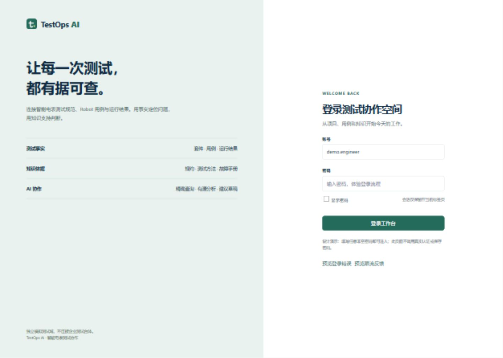
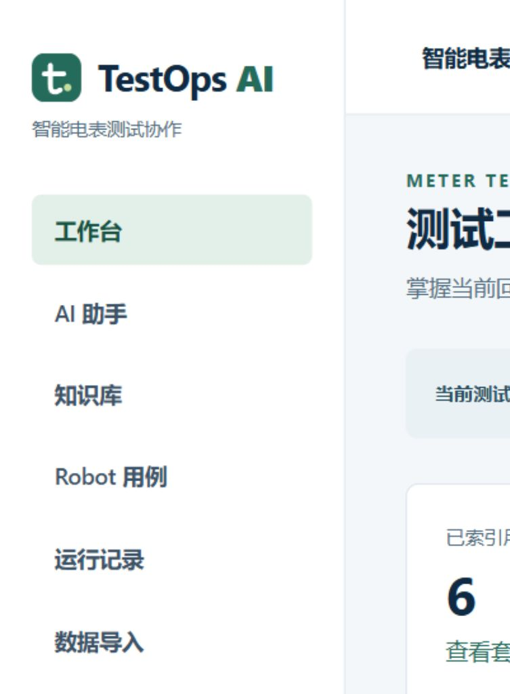
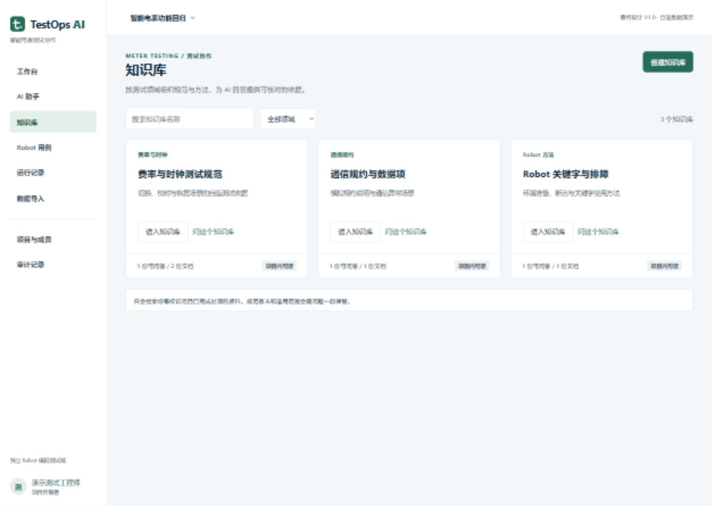
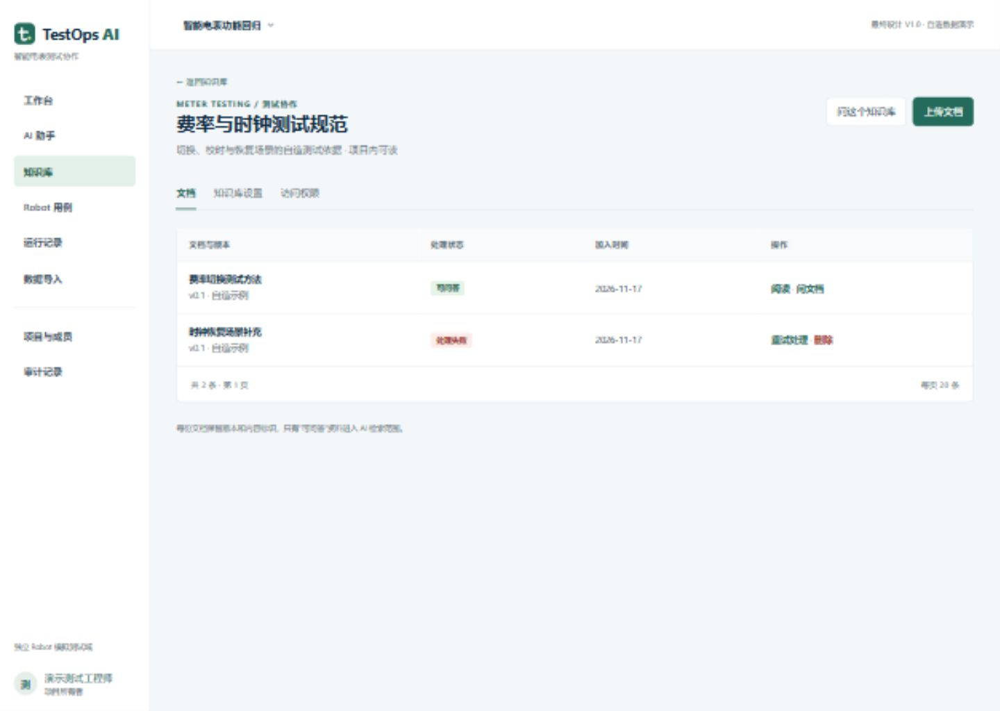
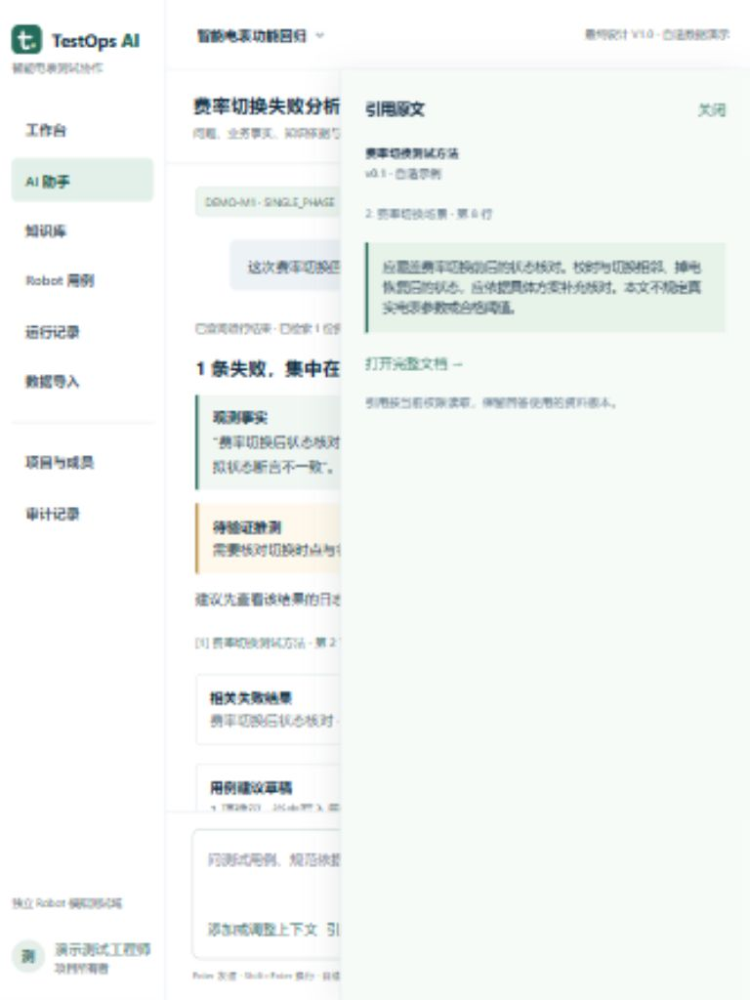
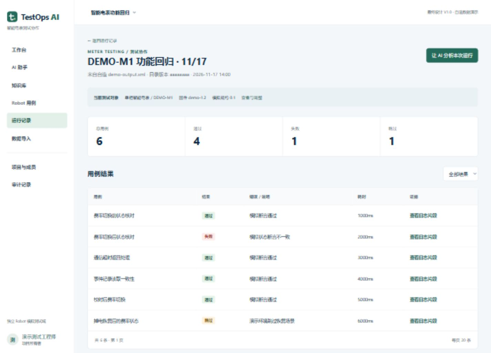

# TestOps AI 最终产品与页面设计 V1.0

日期：2026-11-17。状态：设计基线已确定，替代此前三方向探索；业务功能实现状态另见 CURRENT。本文件与 [三端契约 1.0.0](contracts/README.md)、[ADR-0007](ADR/0007-final-product-contract.md) 一起作为开发输入。

[打开全页面设计原型](design/index.html#/login) · [页面/接口映射](contracts/pages.json) · [领域与迁移模型](DOMAIN_MODEL.md)

原型为可交互的最终界面规格，使用同一组契约自造数据，不依赖模型或设备。可以切换全部页面、筛选、选择用例、查看引用、检查保存草稿和体验表单。它不是生产业务 Web，也不声称新接口已经可调用；正式三端依此实现。页面主体没有“待开放”占位，未纳入产品范围的真实执行功能不展示为可用按钮。

## 1. 系统定位与最终范围

TestOps AI 是面向智能电表 Robot 测试的智能协作系统。并行测试系统提供确定性用例定义与运行产物；TestOps AI 管理自建测试域、规范知识和分析会话，帮助查询、核对、解释与形成建议。当前不直接连接原企业平台、运行器或测试台，数据交换采用自造/有权使用的 Robot 定义与 output.xml 导入。

业务分为：**测试事实、知识依据、AI 协作**。Suite/Case/Tag/Run/Result 用精确 API 查询，规范/手册用 RAG，AI 选择受控工具并整合证据。AI 不决定原始 PASS/FAIL，也不把推测写成已确认设备故障。

最终 V1 范围完整包含：登录、项目工作台、AI 助手、知识库/文档、Robot 套件/用例、运行记录/结果、数据导入、人工建议草稿、项目成员、审计和账户。任务调度、真实设备执行、任意脚本、原企业接口和模型市场不属于此版本；没有这些入口，避免开发出虚假的空页面。

## 2. 工作台与 AI 助手明确分工

| 比较     | 工作台                                                     | AI 助手                                          |
| -------- | ---------------------------------------------------------- | ------------------------------------------------ |
| 用户问题 | 当前项目怎么样，下一项应处理什么？                         | 这个失败如何理解，依据是什么，应该补什么？       |
| 主体     | 最近运行摘要、失败入口、可问答资料、处理失败事项、最近会话 | 提问、受控工具结果、文本回答、引用原文、业务草稿 |
| 输入     | 项目选择与业务筛选，不放大型聊天框                         | 自然语言 + 显式资料/用例/运行上下文              |
| 动作     | 打开运行、处理文档、导入数据、进入已有分析                 | 查询、追问、核对来源、检查草稿                   |
| 数据依据 | Java 结构化聚合，不能让模型生成统计                        | Java 查询事实 + Python 授权知识检索              |
| 结果     | 跳转对应业务页面                                           | 同一会话内沉淀结论和证据，确认后业务落地         |

因此首页大聊天框方案不再采用。AI 的可发现性通过主导航固定入口、工作台“让 AI 分析这次运行”和业务页“问所选内容”保证。

## 3. 统一视觉与布局

浅色工程工作空间，主色青绿 `#256b5b`，正文 `#102a43`，辅助文字 `#526d82`，边线 `#dce5eb`，底色 `#f4f7fa`。错误红与待处理琥珀只表达状态。沿用系统 Segoe UI/微软雅黑，正文 14–16px，标题 28px，数据使用等宽数字，代码使用 Consolas。

全局导航宽 216px，顶部项目栏 72px，内容边距 38px；主要工作面用白底和细分隔，不以营销插画、无来源 KPI 或大面积渐变表达 AI。唯一的核心视觉特征是“业务事实 / 待验证推测 / 来源 / 建议”层次明确。

主导航：工作台、AI 助手、知识库、Robot 用例、运行记录、数据导入；次级导航为项目与成员、审计，账户在底部。知识库详情、文档、用例详情、运行详情、草稿通过上下文进入，不各占一个主菜单。

## 4. 全页面规格与接口

完整字段见 schemas；具体 HTTP 路径见 OpenAPI；以下 operationId 是开发与验收锚点。

| 页面       | 最终内容与主操作                                                                  | operationId                                                                                               |
| ---------- | --------------------------------------------------------------------------------- | --------------------------------------------------------------------------------------------------------- |
| 登录       | 品牌/领域说明与登录表单分栏；账号、密码、显隐、错误、限流倒计时、原目标回跳       | login                                                                                                     |
| 工作台     | 项目上下文、已索引用例数、最近运行统计、可用/失败文档、最近分析入口               | listProjects / getOverview                                                                                |
| AI 助手    | 本人会话列表、历史消息、上下文、事实/推测/引用/结果/草稿、底部输入                | createConversation / sendMessage / streamTurn / cancelTurn                                                |
| 知识库列表 | 领域分类、名称搜索、用途、可读范围、文档就绪概况、创建                            | listKnowledgeBases / createKnowledgeBase                                                                  |
| 知识库详情 | 文档/设置/访问权限三个页签；上传、重试、删除、问此库                              | listDocuments / uploadDocument / retryDocument / deleteDocument / updateKnowledgeBase / setKnowledgeGrant |
| 文档阅读   | 版本、目录、正文块、页码/行号、引用定位、问这篇文档                               | getDocument / getDocumentContent / getCitation                                                            |
| Robot 用例 | 套件树、名称说明搜索、精确标签、跨页选择、来源与优先级                            | listSuites / listTestCases / createCaseSelection                                                          |
| 用例详情   | 定义/关键字步骤/标签/来源行号/版本；Robot 来源只读，人工用例可编辑                | getTestCase / createTestCase / updateTestCase                                                             |
| 运行记录   | 导入来源、对象、时间、统计和完整性，导入结果入口                                  | listRuns / importRobotRun                                                                                 |
| 运行详情   | 原始结果统计、PASS/FAIL/SKIP 筛选、错误/关键字/日志证据、AI 分析                  | getRun / listRunResults / listRunArtifacts / getArtifactLines                                             |
| 数据导入   | Robot 目录与 output.xml 两种独立流程；文件核对、目录版本、任务进度/错误、导入历史 | importRobotCatalog / importRobotRun / getImport                                                           |
| 建议草稿   | 逐项选择、名称/模块/优先级/预期结果编辑、依据、版本、最终确认                     | getDraft / editDraft / commitDraft / discardDraft                                                         |
| 项目与成员 | 项目身份、说明、OWNER/EDITOR/VIEWER，最后 OWNER 保护                              | getProject / updateProject / listProjectMembers / setProjectMember                                        |
| 审计       | 操作人、动作、资源、时间、结果、请求标识，面向 OWNER                              | listAuditLogs                                                                                             |
| 账户       | 当前身份/角色、当前标签页会话说明、退出                                           | currentUser；退出为本地清理，无伪造 logout API                                                            |

### 登录

左侧说明“测试事实、知识依据、AI 协作”的关系，右侧集中表单。登录成功后验证身份，进入原目标或工作台；密码不缓存。401 聚焦错误，429 根据 Retry-After 显示等待，不把限流当网络失败；网络故障保留账号，403 显示权限提示，不无限重试。保留当前已实现的 sessionStorage 约定，不增加“记住我”长期令牌或虚假的找回密码入口。

### 工作台

统计来自 getOverview，并遵守当前成员可见范围；无运行时显示“尚无运行记录”并提供导入，不填虚构 0% 通过率。最近运行卡片的“让 AI 分析”打开带 runId 的会话，失败事项指向实际文档，不在首页另建一份聊天历史。AI 是一个处理动作而非首页装饰。

### 知识库与文档

领域为电能计量、通信规约、费率与时钟、费控、事件、Robot 方法。每库显示用途、就绪数量和可见范围。上传表单包含文件、标题、版本；解析流程按真实 stage 展示，不用伪进度条。FAILED 显示原因和重试，QUEUED/PROCESSING 不可问答，删除展示清理中直至完成。空库直接显示上传入口，搜索无命中提供清空条件，不使用“后续开放”。

文档正文独立阅读，章节目录与行号/页码可定位；点击回答引用打开同一版本同一原文。原文不可见时保留“来源不可访问”状态，不展示缓存摘录。权限页明确 READ/WRITE 与项目角色的交集，不能把限制库授权给项目外用户。

### AI 助手

桌面为会话导航 + 对话 + 按需展开的来源阅读区，避免全局导航后再堆两层常驻侧栏。输入前可见表型、型号、固件/规约版本、资料范围、选择快照和运行；不同会话不可串项目。

回答固定信息层次：**先给结论 → 展示观测事实 → 标注待验证推测 → 引用依据 → 相关结果/用例 → 可编辑建议草稿**。普通规范问答无需硬加结果表，精确查询返回真实业务链接。工具状态显示真实工具摘要，隐藏模型内部推理。没有根据时直接说明缺失项，不输出编造阈值/置信度。

提问模式由意图识别选择工具，不要求用户懂 RAG/Agent；用户控制上下文和目标。建议问题围绕“查 smoke 用例”“解释所选规约”“分析本次失败”。只有选择了运行或明确运行 ID 时才解释运行结果，不从用例启用状态猜测失败。

业务页“问这篇文档/所选用例/本次运行”均创建或继续同一 AI 会话，带对应 ID 快照；有明确当前对象才自动带入。打开助手不自动发问题。“在完整会话中继续”保持同一会话和历史。来源侧栏是按需工具，不在每个业务页永久占据一半空间。

### Robot 用例、运行与导入

用例列表定义结构明确：suite、tags、sourceRef、definition version；生命周期 ACTIVE 与运行 FAIL 分列显示。跨页全选由 Java 选择快照完成，显示最终数量和范围。查询及模型工具用同一个过滤器。

运行页所有数据来自 XML 的确定性标准化结果，保留 unmapped 与 INCOMPLETE，不把“未匹配用例”隐藏为解析成功。错误展开后可看失败关键字与脱敏证据；AI 原因是建议，不覆盖原始 message。

导入分三步：选择材料与项目版本 → 解析检查/错误摘要 → 确认索引或查看运行。目录采用完整快照，仅成功才应用；运行始终新建不可变记录。契约中的 POST 负责校验并创建任务，最终成功/失败由 getImport 读取。没有任意命令输入框或真实设备启动按钮。

### 建议落地

AI 只能创建 EDITABLE 草稿，主按钮“检查并编辑草稿”。确认页面显示实际将保存的字段和数量，用户修改后由 Java 返回新 revision/hash；按钮“确认保存选中 N 条用例”。成功后显示真实 case 链接，重复确认返回原结果；失败事务回滚、保留草稿供修改。生成建议不等于已经实现可运行 Robot 文件。

## 5. 状态与窄屏交互

| 情况                | 必须反馈                               | 恢复方式                       |
| ------------------- | -------------------------------------- | ------------------------------ |
| 资料未就绪/证据不足 | 明确范围与缺项，区分 NONE/PARTIAL      | 换资料、补资料、缩小问题       |
| 用例/结果无命中     | 真实空列表，不编造业务行               | 调整筛选                       |
| 生成中              | 真实阶段与停止按钮，禁止保存未完成内容 | 等待、停止或重连               |
| 断网                | 标注连接中断，保留输入与已有内容       | 事件序号重放，过期读取最终消息 |
| 409 版本/幂等冲突   | 显示变更原因，不静默覆盖               | 重新读取对象后检查             |
| 401/403/撤权        | 身份清理或权限提示，移除不可见内容     | 登录或选择授权资源             |
| 索引/导入失败       | 文件/行号/错误及任务状态               | 修正材料后重传或有界重试       |

≥1280px 显示正文和引用；700–1279px 来源改抽屉并保证主内容宽度；<700px 导航抽屉、全宽会话/引用切换，表格局部滚动。抽屉捕获焦点、Escape 关闭并返回触发点；弹窗使用原生 dialog。表单有标签，状态颜色配文字，中文输入法合成时不触发 Enter 发送，尊重减少动效偏好。

## 6. 三端职责与开发验收

server 是身份、项目/资源授权、精确查询、快照/事务、会话/事件和确认写入的权威；ai 是受限静态解析、索引、RAG 与受控编排；web 只访问 server，持有展示状态，不持有服务密钥，不从图片猜字段。

使用 [pages.json](contracts/pages.json) 的页面 ID 与 operationId 分工。先通过 `npm run contracts:check`，再实现 provider 测试；完成契约切片后联调真实 HTTP/流式/权限场景。接口新增语义必须先共同更新 OpenAPI/schema/ADR，不能只改某个应用内 DTO。

验收须演示：登录/限流 → 项目工作台 → 导入自造 Robot 目录与 XML → 标签查询与选择一致 → 问本次运行 → 精确结果与引用对应 → 检查建议并幂等保存 → 切换权限不能读他人项目/会话/限制库。上述真实运行验收在实现后执行，本轮设计原型与契约自身校验不能替代。

## 7. 背景来源

用户提供 [Robot Framework 业务背景](references/2026-11-17-robot-framework-background.md)，按原字节保留并登记 SHA-256。文档中的数据库/目录/阶段建议经过本稿与 ADR 转化后才成为本项目设计，不把原文的指令当自动执行授权。原始 [立项方案](PROJECT_BLUEPRINT.md) 保留，不改写为新增功能已完成。

## 8. 已核对的页面截图

完整交互以原型为准；下列截图用于离线查看。验证范围和限制见 [设计验证记录](design/VERIFICATION.md)。

