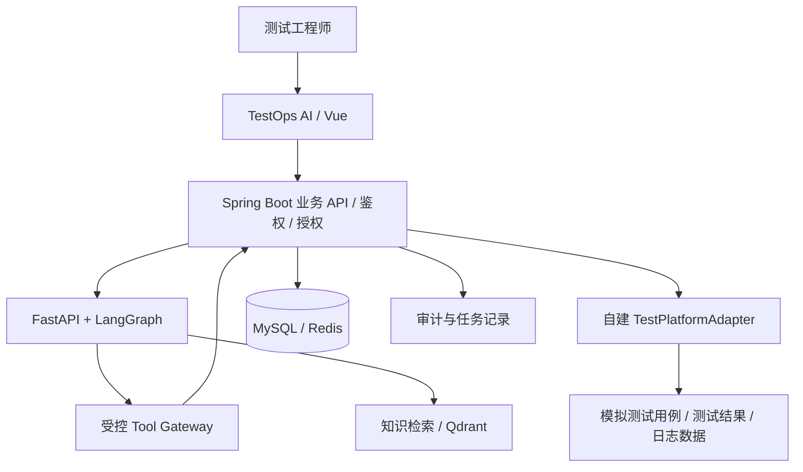
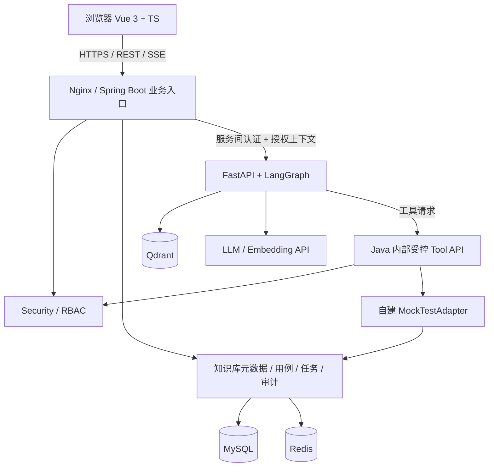
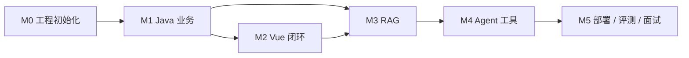

# TestOps AI：项目立项与研发实施方案（V1.0）

> **文档用途**：作为个人项目 `TestOps AI` 的长期需求基线、架构设计起点、开发路线图、Codex 协作依据和技术面试准备材料。可直接放入代码仓库 `docs/PROJECT_BLUEPRINT.md`。
>
> **文档状态**：立项基线 / 设计方案，**不表示功能已经完成**。
>
> **制定日期**：2026-11-16  
> **研发方式**：个人主导，Codex 等 AI 编程工具辅助，边开发边学习  
> **目标岗位**：Java 全栈开发 / AI 应用全栈开发 / 初级 Java 后端  
> **版本说明**：V1.0 确定业务边界和研发方向；具体依赖版本、API 字段和数据表在 M0 设计审查后冻结。

---

## 0. 阅读指引与决策状态

文档中的信息按以下状态管理，防止后续 AI 助手把设计目标当作既成事实：

| 标识 | 定义 | 示例 |
|---|---|---|
| **[已验证]** | 既有项目复盘有明确实现或测试记录支持 | 原测试 Web 控制台基于 FastAPI + Vue 3；452 组圈选一致性反核 |
| **[本人补充/待留证]** | 本人明确表示已发生，但尚需部署记录、截图或使用反馈证明 | 原 Web 控制台“已上线” |
| **[已决策]** | 新项目架构或业务范围已确定，仍待编码实现 | Java 业务入口、Python AI 服务、Vue 前端 |
| **[待实现]** | 新项目目标能力，不得当作现有交付 | RAG、Agent、RBAC、SSE、Docker 部署 |
| **[候选]** | 有替代方案，落地前需验证依赖兼容性或成本 | 部分中间件版本、重排模型与部署方式 |

**项目原则**：简历中的每条技术描述，最终都必须能对应代码、测试、演示或文档证据；没有完成的模块不提前写成已交付经历。

---

## 1. 项目背景、愿景与边界

### 1.1 为什么立项

现有自动化测试体系通常能完成用例组织、执行计划编排、测试结果查看，但日常研发仍依赖人工查找规范、理解日志、关联缺陷和整理排查结论。单纯增加 CRUD 页面无法充分展示 Java 全栈及 AI 应用工程能力，因此开发一套**具有真实业务约束的 AI 智能测试协作平台**。

### 1.2 一句话定位

**TestOps AI 是面向软件测试和研发协作场景的 Java + Python + Vue 全栈平台，以权限受控的知识库问答与 Agent 工具调用连接测试用例、日志和任务流程。**

### 1.3 解决什么问题

1. 技术文档和测试规范散落，检索成本高、回答缺少证据来源。
2. 测试用例、运行记录和日志需要跨系统人工查询、整理。
3. 智能助手只会聊天，不能在**明确授权**的前提下完成结构化业务操作。
4. AI 输出可能出现幻觉、误用数据或越权访问，缺少评测与审计。
5. 个人学习项目往往只有截图和框架堆叠，缺乏完整交付、测试和部署闭环。

### 1.4 用户与场景

| 用户角色 | 主要目标 | 可执行操作 |
|---|---|---|
| 平台管理员 | 管理用户、授权与系统状态 | 用户/角色管理，审计记录查看 |
| 测试工程师 | 查用例、看日志、汇总测试结论 | 管理测试用例与测试任务，知识问答，日志分析 |
| 开发工程师 | 快速定位失败原因、查技术知识 | 按权限查看文档、用例及分析结果 |
| 访客（可选，演示用） | 体验公开内容 | 只能访问明确公开的演示知识库 |

### 1.5 业务原则

- **确定性业务由代码执行，AI 负责理解、检索、规划和解释**：Agent 不直接拼接任意 SQL、执行 Shell、操作真设备。
- **权限先于检索与工具调用**：后端鉴权与数据级权限过滤都必须存在。
- **高风险写操作必须人工确认**：先展示计划，再执行具体动作。
- **资料可溯源**：知识问答支持文档引用；检索不足时明确说明证据不足。
- **个人项目使用公开/自造模拟数据**：禁止复制、上传或连接原公司的私有仓库、用例、日志、参数、密钥、设备网络或客户资料。

---

## 2. 简历中两个项目的定位、关系与组合用法【重点】

> 此章节是两个项目的**叙事和工程边界说明**，不是将个人新项目表述为原公司产品的后续版本，更不能暗示得到原公司授权集成。

### 2.1 两个项目分别是什么

| 维度 | 项目 A：智能设备自动化测试 Web 平台 | 项目 B：TestOps AI 智能测试知识库与 Agent 协作平台 |
|---|---|---|
| 项目属性 | **既有企业工作项目**；个人负责其中完整 Web 控制台及部分测试工程改造 | **新建个人项目**；从零设计、开发、测试、部署 |
| 技术定位 | Python + FastAPI + SQLAlchemy/SQLite + Vue 3/Pinia + Playwright | Java 21/Spring Boot + MySQL/Redis + Vue 3 + Python/FastAPI/LangGraph + Qdrant |
| 核心任务 | 用例检索、筛选、圈选、生成执行计划/运行命令、编排画布、结果查看 | 知识管理、RAG 问答、日志分析、Agent 调用受控工具、任务建议与确认 |
| 核心思路 | **确定性工具平台**：把命令行测试工作流转化为可视化操作 | **智能协作层**：用 AI 缩短理解、检索与操作路径 |
| 主要证明 | 真实工程项目经验、复杂业务交互、共享执行语义、回归测试与工程化治理 | Java 企业级后端、AI 工程、系统设计、跨服务集成、权限安全与部署 |
| 亮点 | 452 组执行计划一致性反核；Web/CLI 共享圈选语义 | RAG 引用/评测；LangGraph 状态和工具；审批；数据权限隔离（**待实现**） |
| 可公开数据 | 只能谈脱敏的通用架构、个人贡献与方法论 | 使用**自行生成/公开许可**的测试用例、日志和知识文档 |

### 2.2 为什么简历同时保留两个项目

两个项目不是简单重复的“Vue + API”。它们承担不同的招聘证明：

- **A 证明“在真实企业项目中，我能开发并验证复杂前后端业务系统”**。
- **B 证明“我能以 Java 为主搭建新的业务后端，并把 AI 安全、可观测地整合到系统中”**。
- 从 A 到 B 的能力升级路径是：**测试业务数字化 → 标准化 API/数据模型 → AI 辅助决策和操作**。
- 在面试中先讲 A 的工程可靠性，再讲 B 的架构演进和 AI 复杂度；不要把 B 的功能归到 A 的工作经历中。

### 2.3 业务职责怎样分工

| 业务步骤 | 确定性测试系统（A 类能力） | TestOps AI（B 类能力） |
|---|---|---|
| 测试用例检索 | 依据字段、标签、模块等**准确检索** | 理解自然语言意图，转换为有约束的查询参数，解释结果 |
| 执行计划 | 依据固定规则圈选用例、生成执行命令 | 理解用户目标、建议筛选范围、说明计划；不能越过校验规则 |
| 测试执行 | 如有执行器，由确定性后端/运行器实施 | 仅调用授权的任务 API；MVP 不操作真实硬件 |
| 结果与日志 | 产生/保存结构化结果并提供查询 | 汇总日志、关联知识库、给出有证据的排查建议 |
| 技术知识 | 存储文档和元数据 | RAG 检索、引用、问答与评测 |
| 权限控制 | 自有系统控制实际操作权限 | Java 业务服务统一授权；Agent 不能绕过 |

**重要纠偏**：原 A 项目的 WebUI 主要是**只读/计算型接口、用例选择与命令生成**。不能在面试中擅自扩展为“我当时开发了 AI 自动执行设备测试/独立完成整个测试框架”。新 B 项目则可以**设计自己的模拟任务执行服务**，避免与原公司系统耦合。

### 2.4 两个项目现在是否直接连在一起？

**当前立项决定：不直接集成原企业项目。**

原因：A 属于原公司工作成果，存在代码、接口、测试数据和访问权限边界；B 是个人可公开展示作品。即使概念上能协作，也不意味着可以复制/调用企业系统。

采用三个层次说明关系：

1. **业务层面的互补（现在就成立）**：A 管测试流程、B 管 AI 知识和智能协作。
2. **个人项目内部的集成（下一阶段开发）**：B 自带 `MockTestAdapter` 和自建测试用例/日志数据，模拟 A 类系统的确定性查询能力，整个链路由个人代码实现。
3. **通用外部系统适配（后续选做）**：设计标准 `TestPlatformAdapter` 接口，使未来在**合法授权和公开 API 条件下**可接第三方测试平台；这不是声称已接入 A。

### 2.5 将来如何技术协作（只用自建适配器演示）



**示例完整链路**（M4 目标）：

1. 用户说：“找到登录模块失败的测试用例，并结合日志分析原因。”
2. Vue 向 Java 业务后端发起对话请求，Java 验证身份、会话和数据访问范围。
3. Java 请求 Python AI 服务处理，传入最小化授权上下文。
4. LangGraph 识别需要用例数据，调用受控 `search_test_cases` 工具。
5. 工具经 Java 内部 API，调用**自建** `MockTestAdapter`，返回结构化、已授权的数据。
6. Agent 调用知识库检索，并结合模拟日志给出分析、证据引用和下一步建议。
7. 若用户要求“创建任务”，Agent 只产生**待确认操作**；Java 完成二次鉴权与确认、幂等检查，才写入任务。
8. Java 记录执行链路与审计信息，Vue 展示流式消息和工具结果。

### 2.6 简历和面试的统一口径

- **项目 A（真实工作经历）**：“我在既有自动化测试工程上，独立实现 FastAPI + Vue 3 Web 控制台，并处理统一圈选逻辑、一致性验证及相关工程化改造。”
- **项目 B（个人项目；完成后）**：“我独立设计实现 Java 业务后端 + Python AI 服务 + Vue 前端的智能测试协作平台，使用自建模拟测试数据演示 RAG、Agent 工具调用、权限和部署。”
- **二者关系**：“B 的需求来自我在 A 项目中观察到的知识检索、日志理解和任务协作痛点，**设计理念延续，但代码、数据、运行环境相互独立**。”
- **禁止表述**：“我把原公司平台升级成 AI Agent 系统”“我已经接入公司真实测试设备/内部系统”（除非未来获得授权且有可证明事实）。
- **A 的上线状态**：用户表示已部署上线，但仍应自留时间、环境、功能范围、访问/使用证据；准确区分个人演示部署、内部部署和生产发布。

### 2.7 按 JD 调整项目顺序

- **Java 后端 / Java 全栈岗位**：B 排第一，突出 Spring Security、MySQL、Redis、事务、权限、测试和部署；A 排第二，展示真实项目经验。
- **AI 全栈 / Agent 应用岗位**：B 排第一，突出 RAG、LangGraph、SSE、工具权限、评测；A 排第二，突出 AI 辅助研发及自动化质量闭环。
- **Python / 自动化平台岗位**：A 排第一，B 排第二，避免抹掉真实 Python 工程优势。
- **正式投递原则**：仅按实际实现情况调整项目描述；不能因 JD 需要就把尚未完成的能力写为“已掌握/已交付”。

---

## 3. 项目范围与功能规划

### 3.1 MVP 核心业务（必须实现）

| 编号 | 业务模块 | 必须实现的最小功能 | 验收输出 |
|---|---|---|---|
| F01 | 用户及权限 | 登录、退出、JWT 验证、管理员/普通用户 RBAC | 越权访问稳定被拒绝 |
| F02 | 知识库 | 创建、列表、文档上传、解析状态、删除 | 文档状态可观察 |
| F03 | 文档检索问答 | 分块、Embedding、Qdrant 检索、引用与 SSE 输出 | 真实引用且权限隔离 |
| F04 | 测试用例 | 模拟用例 CRUD/查询、状态/标签筛选 | 可通过 Java API 精确查询 |
| F05 | Agent 工具 | LangGraph 至少调用一个业务查询工具 | 保留可验证工具调用记录 |
| F06 | 前端体验 | 登录、知识库管理、用例管理、AI 对话 | 完整前后端链路 |
| F07 | 工程交付 | Docker Compose 一键启动、自动化测试、README | 新环境可复现启动 |

### 3.2 第二阶段增强（MVP 稳定后）

- Rerank 重排序、关键词+向量混合检索、RAG 评测。
- 模拟测试日志分析与错误类型归因。
- LangGraph Checkpointer、会话恢复、工具重试策略。
- 涉及修改任务状态的人工确认与审计。
- MCP Server 封装测试查询工具（与普通函数工具调用作对照）。
- 任务执行历史、日志检索与基础可观测性。

### 3.3 明确不做

- 不连接原企业代码仓库、内部网络、真实设备或台体。
- 不开放任意 SQL、任意 Shell 或设备控制给模型。
- 不做微服务集群、Spring Cloud、Kubernetes、复杂多 Agent 平台、模型微调训练。
- 不做商业计费、多租户 SaaS 完整体系、重型工作流画布。
- 不为了“简历看起来复杂”引入没有业务价值的中间件。

### 3.4 关键业务流程

**流程 A：知识库问答**

`登录 → 创建知识库 → 上传公开/自造文档 → 解析与索引任务 → 检索权限过滤 → 召回 → [可选重排] → 生成含引用的回答 → 保存会话/评测`。

**流程 B：智能查用例**

`用户提问 → Java 鉴权与确定查询范围 → Agent 意图识别 → 参数校验 → 工具调用 Java API → 自建用例数据查询 → 结构化结果 → AI 总结`。

**流程 C：智能日志分析（增强）**

`上传模拟日志 → 解析错误片段 → Agent 按权限查询用例/知识库 → 汇总证据 → 输出可能原因与检查建议`。

**流程 D：创建测试任务（增强）**

`用户提出需求 → Agent 生成结构化草案 → 前端展示 → 人工确认 → Java 再次鉴权及幂等校验 → 写入任务/审计 → 返回状态`。

### 3.5 最小成功演示脚本

1. 以管理员登录，创建普通测试用户，并为其授权。
2. 创建知识库，上传三份**自造**的 Markdown/PDF 技术资料。
3. 以普通用户提问，获得流式回答与可点击的文档来源。
4. 切换用户，验证无法检索他人的私有文档。
5. 在聊天中输入：“查找 `login` 模块失败的测试用例”，看到 Agent 真实调用查询工具并返回结构化结果。
6. 打开用例页面，验证 Agent 返回的数据与正常业务 API 一致。
7. 展示 Docker Compose 运行状态、自动化测试报告及一条完整审计记录。

---

## 4. 技术选型与架构决策

### 4.1 技术栈基线

| 层 | 方案 | 选择理由 |
|---|---|---|
| Java 运行时 | Java 21 | 稳定 LTS，适合企业级后端学习 |
| 业务后端 | Spring Boot 3.5.x、Spring MVC、Spring Security、MyBatis-Plus | Java 核心面试体系与成熟业务生态 |
| 前端 | Vue 3、TypeScript、Vite、Pinia、Vue Router | 与既有能力连续，可快速做复杂交互 |
| AI 服务 | Python、FastAPI、LangGraph | Python AI 生态成熟，便于编排和独立测试 |
| 主数据库 | MySQL 8.x | 用户、权限、文档元数据、测试用例、任务与审计 |
| 缓存 | Redis | 业务缓存、限流辅助；初期不承担事实唯一存储 |
| 向量库 | Qdrant | Embedding 检索、metadata 过滤和知识库隔离 |
| 文档处理 | Markdown / PDF 解析 + Embedding 模型 | 构建可演示的 RAG 数据流程 |
| 部署 | Docker Compose、Nginx | 单机复现部署，符合 MVP 成本 |
| 测试 | JUnit 5、Spring Boot Test、pytest、Playwright | 业务、AI 服务、前端 E2E 分层验证 |
| AI 辅助开发 | Codex + 仓库 `AGENTS.md` + Git Diff | 适应“边开发边学习”，避免 AI 产出不可解释代码 |

**版本约束**：上述为候选基线，项目初始化时必须查官方文档确认 Spring Boot / MyBatis-Plus / Java / Python 依赖兼容关系并锁定版本；不得无验证升级主版本。模型厂商、Embedding 和 Rerank 应通过抽象接口替换，避免被特定 API 绑定。

### 4.2 架构图



### 4.3 服务职责划分（必须保持）

**Vue 前端**

- 负责 UI、表单校验、登录态展示、流式消息和执行确认交互。
- 不直接持有模型 API Key；不绕过 Java 访问 Python 内部服务。
- 前端隐藏按钮只是 UX，不代替 Java 服务端鉴权。

**Java Spring Boot**

- 唯一对外的业务 API 网关/入口，处理认证、角色、权限、业务数据、任务、审计。
- 维护用户身份与知识库所有权；上传文件元数据和处理状态由 Java 记录。
- 代理或协调 AI 请求；工具实际查询和写入通过受控 Java 内部 API。
- 文件上传需做格式、大小、路径与内容安全检查；后台索引任务可异步触发。

**Python FastAPI + LangGraph**

- 文档解析、分块、Embedding、RAG、Agent 工作流、LLM 请求和工具选择。
- 不对普通浏览器公开无保护入口。
- 通过 Java 提供的**最小授权上下文**和服务间凭据调用受控 Tool API；不直接查询 Java 业务表。
- 不把用户原始 JWT、数据库凭据、完整私有文档无约束转交第三方模型。

### 4.4 关键架构决策记录（ADR 初稿）

| ADR | 决策 | 为什么 | 不选择什么 |
|---|---|---|---|
| ADR-001 | Java 单体业务后端 + 独立 Python AI 服务 | Java 展示业务能力，Python 承担 AI 生态 | 初期 Spring Cloud 微服务 |
| ADR-002 | Vue 只访问 Java 入口 | 统一鉴权、授权、审计与限流 | 浏览器直连 AI 内部服务 |
| ADR-003 | MySQL 保存业务事实，Qdrant 保存向量索引 | 事务与检索职责分离 | 用向量库代替业务库 |
| ADR-004 | 原企业项目与新个人项目隔离 | 避免产权与数据权限风险 | 复制企业代码作为个人项目基础 |
| ADR-005 | Agent 通过受控工具 API 操作 | 最小权限、可测与可审计 | AI 直接执行 SQL/Shell |
| ADR-006 | 人工确认用于有副作用操作 | 防止误操作 | 模型自动执行所有写入 |
| ADR-007 | MVP 采用 Docker Compose | 部署简单、适合学习期 | 一开始上 K8s |

---

## 5. 核心业务数据模型（M0 设计草案）

### 5.1 业务实体

| 实体/表（建议） | 主要字段（示意） | 责任与关系 |
|---|---|---|
| `users` | `id, username, password_hash, status, created_at` | 用户 |
| `roles` / `user_roles` | `role_id, role_code` / `user_id, role_id` | RBAC |
| `knowledge_bases` | `id, name, owner_id, visibility, status` | 知识库归属与可见性 |
| `kb_members`（如需要共享） | `kb_id, user_id, access_level` | 知识库共享授权 |
| `documents` | `id, kb_id, filename, object_key, checksum, status, created_at` | 文件元数据与索引状态 |
| `ingestion_jobs` | `id, document_id, status, error_code, started_at, finished_at` | 可恢复的解析/索引状态 |
| `test_cases` | `id, project_key, module, title, tags, priority, expected_result` | **自建模拟**测试用例 |
| `test_runs` / `test_results`（增强） | `id, case_id, status, started_at, summary` | 模拟执行记录 |
| `conversations` / `messages` | `id, user_id, kb_id, role, content, created_at` | 对话历史；敏感内容最小化保存 |
| `agent_tool_calls` | `id, conversation_id, tool_name, request_id, status, duration_ms` | 工具调用记录 |
| `action_approvals`（增强） | `id, user_id, action_type, payload_hash, status, expires_at` | 人工确认流程 |
| `audit_logs` | `id, actor_id, action, resource_type, resource_id, result, time` | 安全审计 |

**数据设计要求**：

- 主键统一规范；核心查询字段建立合理索引；使用迁移脚本管理表结构。
- 知识库向量 metadata 包含 `document_id / kb_id / owner_scope / chunk_index / version`；向量索引与数据库元数据保持可追踪映射。
- 文档删除需要同时处理 MySQL 元数据、文件对象和向量索引，失败可重试、可补偿。
- 所有业务资源的查询与更新需要**数据级授权**，不能只依靠登录态。
- 统一 UTC 存储时间，前端按用户时区展示；日志包含 requestId/traceId。
- 不把完整密钥、密码、原始模型请求敏感信息写进日志。

### 5.2 核心状态机

**文档索引**：`UPLOADED → PENDING → PROCESSING → READY`，异常可进入 `FAILED`，删除进入 `DELETING → DELETED`，支持有界重试。

**AI 任务**：`CREATED → RUNNING → COMPLETED/FAILED/CANCELLED`；增强阶段加入 `WAITING_APPROVAL` 和恢复逻辑。

**人工审批**：`PENDING → APPROVED/REJECTED/EXPIRED`，审批动作应满足“一次确认、一次执行”的幂等约束。

### 5.3 文件安全边界

仅允许白名单格式与大小，文件名不作为磁盘绝对路径；解析在资源受限环境下执行，防止恶意 PDF/压缩炸弹和任意文件访问。对上传文本内的“忽略规则、调用工具”等提示词注入内容视为**不可信文档数据**，不可作为系统指令执行。

---

## 6. API 契约草案（M0 冻结具体字段）

### 6.1 对外 REST API（均由 Java 暴露）

| 方法 | 路径 | 用途 | 权限 |
|---|---|---|---|
| `POST` | `/api/v1/auth/login` | 登录并签发短期访问令牌 | 公开，需限流 |
| `GET` | `/api/v1/users/me` | 当前用户 | 已登录 |
| `GET/POST` | `/api/v1/knowledge-bases` | 列表 / 创建知识库 | 已登录 + 数据级授权 |
| `POST` | `/api/v1/knowledge-bases/{id}/documents` | 上传文档 | 该 KB 写权限 |
| `GET` | `/api/v1/documents/{id}/status` | 索引状态 | 该文档读权限 |
| `GET` | `/api/v1/test-cases` | 查询模拟用例 | 已登录 + 项目数据权限 |
| `POST` | `/api/v1/ai/conversations` | 创建对话 | 已登录 |
| `POST` | `/api/v1/ai/conversations/{id}/messages/stream` | AI 流式响应 | 会话拥有者 |
| `POST` | `/api/v1/actions/{id}/approve` | 确认有副作用操作（增强） | 本人 + 资源权限 |
| `GET` | `/api/v1/audit-logs` | 审计查询（增强） | 管理员 |

**统一约定**：API 版本前缀、结构化错误码、请求 ID、分页排序字段、鉴权失败 `401` 与无权 `403` 区分、重要写操作的幂等键均写进 OpenAPI 文档。

### 6.2 服务内 API

| 路径（示意） | 调用方向 | 说明 |
|---|---|---|
| `POST /internal/ai/chat/stream` | Java → Python | 带最小授权上下文的 AI 流式处理 |
| `POST /internal/ai/index-document` | Java → Python | 文档索引任务 |
| `POST /internal/tools/test-cases/search` | Python → Java | 查询受控的模拟用例数据 |
| `POST /internal/tools/task/draft` | Python → Java | 创建待确认任务草案（增强） |

**服务间安全**：内部 API 不直接暴露公网；校验服务身份、请求时效和作用域；用户级操作仍由 Java 二次检查资源权限。不要信任 Python/LLM 自行声称的 `user_id`。

### 6.3 SSE 事件协议（建议）

定义稳定、前后端可测试的事件结构，至少包括：

```text
event: message.delta
data: {"conversationId":"...","text":"..."}

event: tool.start
data: {"toolCallId":"...","tool":"search_test_cases"}

event: tool.end
data: {"toolCallId":"...","status":"success"}

event: message.done
data: {"conversationId":"...","finishReason":"stop"}
```

错误使用 `event: error`，心跳使用注释行；客户端中断后按设计清理上游请求或允许任务独立持久运行。**不要将模型原始供应商协议直接当成前端业务协议**。

---

## 7. AI 设计：RAG、Agent、评测与安全

### 7.1 RAG 基础链路

1. 文档上传和校验（公开/自造材料）。
2. 内容解析与标准化，保留页码、标题、段落等来源定位。
3. 按文档结构进行合理分块，记录 chunk 与来源关系。
4. 调用 Embedding 模型，写入 Qdrant，包含可授权过滤的 metadata。
5. 提问时先进行权限过滤，再做向量检索。
6. 检索为空或证据不足时给出明确提示，不臆造答案。
7. 生成回答并返回引用，前端可跳转对应文档片段。
8. 使用固定评测集记录召回质量和引用准确性，增强阶段添加 Rerank。

**MVP 不追求复杂算法；先保证可引用、可授权、可测试。**

### 7.2 Agent 最小闭环

- 状态：`user_request`、`authorized_scope`、`messages`、`tool_results`、`status`。
- 节点：意图解析 → 路由 → 受控工具调用/知识检索 → 汇总 → 结束。
- 工具示例：`search_test_cases`、`get_test_case_detail`；增强阶段 `analyze_test_log`、`draft_test_task`。
- 每个工具必须有 JSON Schema 或 Pydantic 参数校验、超时、错误码与访问控制。
- 写操作由 Java 服务端校验身份和资源权限；加入审批、幂等及审计。
- Checkpointer 用于可恢复状态；不要把它误认为全平台业务数据库。

### 7.3 RAG/Agent 评测集（至少 30 条）

| 类型 | 建议数量 | 目标 |
|---|---:|---|
| 有依据的文档问答 | 10 | 检索命中、来源引用正确 |
| 跨文档关联问答 | 5 | 多来源整合，不编造 |
| 文档中不存在的问题 | 5 | 正确拒答或说明证据不足 |
| 不同用户权限隔离 | 5 | 禁止跨权限召回和引用 |
| Agent 工具调用与异常 | 5 | 参数正确、权限正确、故障有恢复或解释 |

指标建议记录：`Recall@K`（有标注答案时）、引用支持率、任务完成率、错误工具调用次数、权限绕过次数、P50/P95 时延（有数据时）。**指标必须来自真实运行，不能为了简历编数值。**

### 7.4 AI 风险边界

- 防提示词注入：外部文档、工具返回值都视为不可信内容，不可覆盖系统约束。
- 最小权限：工具只允许固定操作和结构化参数，不接受任意代码/SQL。
- 数据隔离：知识库和用例查询都加用户/资源范围约束，不能仅靠 Prompt。
- 人工确认：改变状态、删除、批量操作必须人工确认；确认对象和执行对象需绑定。
- 费用约束：LLM 请求超时、重试上限、调用量/Token 监控与限流。
- 可追溯：保存必要的请求 ID、工具名称、状态和错误；敏感原文脱敏或不存储。

---

## 8. 开发路线图、依赖关系与验收门槛

> 以下是**里程碑顺序**，不是工期承诺。允许根据实际学习进度调整，但必须先满足前置验收再进入下一阶段。

### M0：立项与工程骨架

**工作**：创建仓库；冻结需求边界；初始化 `apps/web`、`apps/server`、`apps/ai-service`；编写 ADR、数据草图和 API 契约；Docker 基础设施；`AGENTS.md` 和 CI 基础命令。

**交付物**：`README.md`、`docs/PROJECT_BLUEPRINT.md`、`docs/ARCHITECTURE.md`、`docs/API.md`、`docs/ROADMAP.md`、`.env.example`、基础服务健康检查。

**验收**：一条命令能启动基础服务；配置示例可用；所有服务健康检查正常；无密钥提交；项目目录与文档一致。

### M1：Java 核心业务后端

**工作**：用户、角色、登录、JWT/RBAC；知识库元数据；测试用例 CRUD/查询；MySQL 表迁移；Redis 缓存/限流；统一错误处理与接口测试。

**验收**：在无 Vue 的情况下通过 API 工具完成完整用户与业务流程；正确返回 `401/403`；数据库事务和关键接口有测试。

### M2：Vue 全栈闭环

**工作**：登录页、布局、知识库列表、文档管理、用例管理、请求封装、Pinia 状态、路由守卫和基础 E2E。

**验收**：浏览器可以完整完成登录、权限限制、知识库管理和用例查询；关键功能 Playwright 测试可重复通过。

### M3：AI 知识问答

**工作**：FastAPI AI 服务；文档解析、分块、Embedding、Qdrant 索引；检索过滤；问答引用；Java 入口代理的 SSE。

**验收**：上传文档能问答且显示引用；未授权用户拿不到其他用户的片段；断流/超时有错误处理。

### M4：Agent 工具协作

**工作**：LangGraph 状态和路由；通过 Java Tool API 查询模拟用例；工具审计；增强阶段增加日志分析、Checkpointer、人工确认和 MCP 适配。

**验收**：至少一个真实工具调用闭环；返回结果可与业务 API 对照；越权和异常路径测试通过。

### M5：工程化、评测和面试材料

**工作**：Docker Compose + Nginx；环境变量与密钥管理；日志与指标；RAG/Agent 测试集；演示数据；架构图、README、部署教程；项目介绍和深度面试问答。

**验收**：从空环境按 README 可启动；有完整演示路径和测试报告；能解释数据流、权限流、异常流以及关键取舍。

### 里程碑依赖图



### 开发节奏（边学边做）

每天参考投入：项目开发/调试 2.5 小时，技术原理 1 小时，算法与面试 1 小时，投递和沟通 0.5 小时；有面试时动态调整。**不要等所有模块完成才投递**，普通全栈的可演示闭环一旦稳定就可开始匹配岗位。

---

## 9. 学习计划与简历技能映射

| 技能方向 | 必学（P0） | 提升（P1） | 项目证据 | 常见面试追问 |
|---|---|---|---|---|
| Java 基础 | 集合、泛型、异常、线程、锁、线程池 | JVM/GC、CompletableFuture | 后端任务、接口测试 | HashMap、线程池、volatile、锁竞争 |
| Spring | IOC、AOP、MVC、Security、事务 | 事务传播、异步任务隔离 | 登录、RBAC、事务 | 事务失效、Filter Chain、鉴权流程 |
| MySQL/Redis | 表设计、索引、事务、缓存、TTL | 慢 SQL、缓存一致性策略 | 知识库/用例表、Redis | 联合索引、幻读、缓存穿透 |
| Vue 3/TS | ref/reactive、组件、Pinia、Router、Promise | 性能优化、组件抽象 | 可演示 Web UI | 响应式原理、路由鉴权、状态拆分 |
| Web/部署 | HTTP、JWT、CORS、SSE、Docker | 反向代理、日志、故障恢复 | 部署脚本、E2E | SSE vs WebSocket、断线处理 |
| RAG | 分块、Embedding、检索、引用、权限过滤 | Rerank、混合检索、评测指标 | 文档问答 + 评测集 | 幻觉、召回与重排、跨租户泄露 |
| Agent | Tool Calling、LangGraph 状态、路由 | 持久化、人工确认、MCP | 工具调用记录 | 为什么需要状态机、如何防越权 |
| AI 辅助研发 | Codex 任务拆解、代码审查、单测 | 架构评审、提示词与成本管理 | Git Diff + 测试记录 | AI 写的代码出错你如何定位 |

**学习原则**：知识点至少具备 **原理解释 + 亲手修改代码 + 测试验证 + 能回答追问** 四种证据。不把“AI 生成过的代码能运行”作为唯一通过标准。

**暂缓投入**：Spring Cloud、Kafka、Kubernetes、多 Agent 大规模协同、模型训练。若目标 JD 强制要求，再按岗位差异补充。

---

## 10. 仓库结构与协作文档

```text
testops-ai/
├── apps/
│   ├── web/                  # Vue 3 + TypeScript
│   ├── server/               # Spring Boot 业务后端
│   └── ai-service/           # FastAPI + LangGraph
├── infra/
│   ├── nginx/
│   └── docker/
├── docs/
│   ├── PROJECT_BLUEPRINT.md  # 本文档
│   ├── ARCHITECTURE.md       # 详细架构与权限流
│   ├── DATABASE.md           # 表结构、索引与迁移说明
│   ├── API.md                # REST/SSE/内部工具契约
│   ├── ROADMAP.md            # 任务拆分与验收记录
│   ├── INTERVIEW.md          # 面试讲解与设计取舍
│   └── ADR/                  # 架构决策记录
├── samples/                  # 完全自造/公开许可演示数据
├── tests/                    # 跨服务契约测试、E2E 和评测集
├── AGENTS.md                 # Codex 的长期仓库约束
├── .env.example              # 仅示例，不包含真实密钥
├── compose.yaml
└── README.md
```

### 10.1 文档维护规则

- `PROJECT_BLUEPRINT.md`：需求基线与范围变化；不能随意删掉“非目标”。
- `ARCHITECTURE.md`：运行时调用链、授权边界、文件处理与部署拓扑。
- `DATABASE.md`：表、索引、约束、迁移版本与存储一致性策略。
- `API.md`：OpenAPI、SSE 事件协议与服务内工具契约。
- `ROADMAP.md`：每个任务的完成状态、验收证据和阻塞事项。
- `ADR/`：重要技术选择记录背景、方案、收益、代价、替代选项。
- `INTERVIEW.md`：项目陈述、原理、事故/踩坑与追问。

任何改变核心数据流或权限模型的代码变更，必须同步更新相关文档和测试。

---

## 11. Codex 协作规范与第一阶段提示词

### 11.1 分工

**你负责**：需求优先级、关键架构选择、复核 AI 生成代码、运行验证、解释设计与面试表达。

**Codex 负责协助**：分析仓库、拆分小任务、生成初版代码与测试、定位问题、重构、更新文档、提示可能的兼容和安全风险。

**绝对不能委托出去的判断**：未经验证就宣布测试通过、决定生产安全边界、把企业资料复制入个人仓库、把假设写成简历事实。

### 11.2 每次任务的标准工作流

1. **读上下文**：先读 `AGENTS.md`、本项目文档、相关代码与最近决策。
2. **小步规划**：列出要改的文件、接口、测试和风险。
3. **实现**：每次只完成一组相关职责，避免跨栈无目的大重构。
4. **验证**：编译/类型检查/单元测试/集成测试；报告实际执行命令和结果。
5. **复核**：检查 Git Diff、权限、异常、日志、边界条件与敏感信息。
6. **学习**：解释核心代码、替代方案、为什么选当前实现。
7. **记录**：更新进度、ADR 和测试证据；提交前由你亲自确认。

### 11.3 建议写入仓库 `AGENTS.md` 的规则

```markdown
# AGENTS.md — TestOps AI

## 目标
开发可运行、可测试、可演示的 Java + Vue + Python AI 全栈系统；个人开发者边开发边学习。

## 核心边界
- Java/Spring Boot 管认证、授权、业务数据、任务和审计。
- Python/FastAPI 管 RAG、LLM、Agent；业务操作通过受控 Java API。
- Vue 前端只通过 Java 统一入口访问服务。
- 禁止使用原公司私有代码、数据、密钥、内网地址和设备接口。
- 禁止 AI 直接执行任意 SQL、Shell 或真实设备控制。

## 工作规则
- 先阅读 docs/PROJECT_BLUEPRINT.md、相关 ADR 和接口契约。
- 实现前列清目标、影响范围、失败路径和验收标准。
- 优先小步变更；不要同时引入多个非必要框架。
- 每次改代码运行相关测试；未运行则明确标注“未验证”。
- 不伪造测试结果、性能指标、上线状态或项目功能。
- 权限校验必须在服务端完成；工具调用必须最小权限、参数校验和审计。
- 新依赖先确认官方版本兼容性，锁定版本，说明引入原因。
- 不提交 .env、密钥和含敏感数据的日志。
- 不擅自推送代码、不执行破坏性命令、不修改无关文件。

## 交付格式
1. 已实现内容；2. 修改的主要文件；3. 已执行的测试及结果；
4. 未覆盖风险；5. 学习要点；6. 下一步建议。
```

### 11.4 可直接发给 Codex 的 M0 启动指令

```text
你是 TestOps AI 的高级工程开发助手，我是项目负责人。

先读取 AGENTS.md 和 docs/PROJECT_BLUEPRINT.md（若尚未复制到仓库，先将我提供的立项文档作为唯一需求基线）。
项目采用 Java 21 + Spring Boot 3.5.x + Spring Security + MyBatis-Plus、
Vue 3 + TypeScript + Vite + Pinia、Python + FastAPI + LangGraph、
MySQL + Redis + Qdrant、Docker Compose + Nginx。

本次只执行 M0，不开发完整业务功能：
1. 检查当前 Git 仓库、环境及现有文件。
2. 依据立项文档生成 ARCHITECTURE.md、DATABASE.md、API.md、ROADMAP.md。
3. 对 Java、前端、Python、Docker 服务创建可启动的最小骨架。
4. 确定服务边界、权限边界、环境变量及健康检查。
5. 锁定可兼容的依赖版本，记录依据和 ADR。
6. 写明本地启动命令、测试命令和第一批验收用例。

严格要求：
- 不接触任何企业私有系统；仅使用自造演示数据。
- 不引入 Spring Cloud/K8s；不提前实现 RAG、Agent 复杂逻辑。
- 先给出改动计划再实施；关键技术选择要解释原因。
- 每步执行真实验证；失败时说明失败原因，不宣称通过。
- 不伪造性能结果、提交记录或部署状态。
- 完工后给出修改文件、运行命令、测试证据、学习知识点和后续任务。
```

---

## 12. 质量门禁、交付物与验收清单

### 12.1 各层测试

| 测试层 | 主要对象 | 典型案例 |
|---|---|---|
| Java 单元/集成 | 认证、RBAC、事务、MyBatis、API | 无权限读取 KB 返回 403；文档删除状态一致 |
| Python 单元/契约 | RAG 管道、Tool schema、Agent 状态 | 无检索证据不乱答；工具参数错误被拒绝 |
| 前端组件/E2E | 登录、知识库、SSE、错误处理 | 流式消息可更新；断线后提示可理解 |
| 跨服务契约 | Java ↔ AI ↔ Tool API | requestId 贯通、错误码一致、工具无越权 |
| 安全回归 | 资源越权、上传、Prompt Injection | 其他用户知识库无法被检索；文档内容不能触发工具越权 |
| AI 评测 | 问答与工具行为 | 30 条固定测试数据集、结果有记录 |

### 12.2 “完成”定义（DoD）

一项功能必须同时满足：

- [ ] 按本项目的业务场景可以真实操作，而不是静态页面或预设回答。
- [ ] 有明确的输入、输出、错误路径和权限校验。
- [ ] 关键逻辑有测试；测试命令和结果可复现。
- [ ] 不包含企业私有内容及真实密钥。
- [ ] 对关键设计取舍有文档，能由开发者口头解释。
- [ ] 更新 API/数据库/进度文档，截图或日志留有证据。

### 12.3 项目交付包

- 可运行代码仓库，完整 `.env.example` 与依赖锁定信息。
- 本地单机启动和部署指南、架构图、ER 图、API 文档。
- 模拟业务数据、公开/自造知识资料及用户体验脚本。
- 自动化测试报告、RAG/Agent 评测样本与真实结果。
- 录屏或截图、面试讲解稿、主要问题与决策复盘。

---

## 13. 求职与面试材料准备

### 13.1 项目讲解结构（1 分钟）

**TestOps AI（个人项目完成后）**：我开发了一套面向软件测试场景的 AI 全栈平台，Java Spring Boot 处理用户鉴权、知识库与测试业务，Vue 负责管理界面，Python FastAPI + LangGraph 处理文档问答和 Agent 工具调用。系统通过受控 Java API 查询模拟测试数据，并用检索权限、来源引用、工具审计和自动化测试保证可靠性。部署采用 Docker Compose，关键功能有可复现的测试证据。

**原自动化测试 Web 平台（工作项目）**：在既有测试工程上，我独立实现 FastAPI + Vue 3 Web 控制台，将用例检索、圈选、命令生成、编排和结果查看图形化；通过共享的运行器语义与 452 组一致性验证保障 Web 与命令行行为一致，并参与测试工程改造和自动化质量保障。

**两个项目的关系**：企业项目教会我如何把复杂测试流程做成可靠的软件系统；个人项目则在**独立的模拟环境**中探索如何用 Java 全栈与 Agent 把知识检索、日志理解及任务协作提升到下一阶段。

### 13.2 至少能回答的问题

1. 为什么 Java 负责业务，Python 负责 AI？为什么不全用 Python？
2. JWT 如何校验？RBAC 和数据级权限有什么区别？
3. `401` 与 `403` 区别？前端路由守卫为何不够？
4. Spring 事务失效有哪些典型场景？
5. MySQL 与 Redis 如何设计缓存和一致性？
6. 上传文档如何从数据库状态进入向量索引？失败怎样恢复？
7. RAG 的检索结果和回答引用如何评测？
8. Qdrant metadata 过滤为何是必要的权限约束？
9. Agent 如何选择工具？工具调用失败如何处理？
10. 为什么不允许 Agent 执行任意 SQL/Shell？
11. SSE 与 WebSocket 的取舍？断流如何处理？
12. LangGraph 的 State、Checkpoint、Interrupt 分别解决什么问题？
13. 怎么保证 Java、Python、Vue 三端的接口契约一致？
14. 原测试 Web 控制台为什么要共享运行器语义并做 452 组反核？
15. 使用 Codex 时，如何验证 AI 生成的代码，而不是盲目接受？

### 13.3 简历事实核对表（交付后再逐项更新）

| 简历表述 | 当前状态 | 必需证据 |
|---|---|---|
| 原测试 WebUI 独立开发 | [已验证] | 工作复盘中代码归属、具体功能及技术范围 |
| 原 WebUI 已上线 | [本人补充/待留证] | 环境、时间、功能范围、部署或使用记录 |
| 452 组执行计划一致性校验 | [已验证] | 校验脚本、口径与结果 |
| 新项目 Spring Security/JWT/RBAC | [待实现] | 权限链路与越权测试 |
| 新项目 RAG/Qdrant/Rerank | [待实现] | 实际代码、检索报告、演示 |
| 新项目 LangGraph/MCP/人工确认 | [待实现] | 真实工具调用、状态恢复、审批测试 |
| 新项目已部署 | [待实现] | Compose、运行截图、可复现 README |

**注意**：个人项目的“已完成”事实不能回填到之前公司的任职成果中。项目时间以真实开发记录为准。

---

## 14. 立即开始的第一批任务（M0）

按下列顺序交给 Codex，每一步都可独立检查：

- [ ] **M0-01** 建立 Git 仓库与基础 `.gitignore`，确认无企业私有数据。
- [ ] **M0-02** 将本文件保存为 `docs/PROJECT_BLUEPRINT.md`。
- [ ] **M0-03** 抽取 `README.md`、`AGENTS.md`、`ROADMAP.md`，不要把全部文字重复贴满各文件。
- [ ] **M0-04** 确定 Java / Python / Node / Docker 的具体版本与依赖兼容组合。
- [ ] **M0-05** 生成 `ARCHITECTURE.md` 和 ADR-001～ADR-007。
- [ ] **M0-06** 生成 Java 数据实体草案、ER 图与首批 Flyway 迁移（按需引入）。
- [ ] **M0-07** 定义登录、知识库、测试用例、文档索引与 AI SSE 的接口契约。
- [ ] **M0-08** 初始化 Java、Vue、Python 三端骨架，并实现 `health` API。
- [ ] **M0-09** 完成 MySQL、Redis、Qdrant 的 Compose 启动与健康检查。
- [ ] **M0-10** 建立编译、类型检查、单测的最小自动验证命令；记录实际输出。

### 第一轮验收问答

**能够回答以下六个问题，M0 才算完成：**

1. 用户从浏览器进入以后，认证与授权究竟发生在什么位置？
2. AI 服务要查询测试用例时，为什么必须走 Java 的受控 API？
3. MySQL、Redis、Qdrant 分别存什么？为什么不能互相替代？
4. 如何证明两个简历项目有关联的业务思想，但没有违规复用原公司资产？
5. 从空目录如何启动三种应用和三个基础设施服务？
6. 当前有哪些功能仍然只是设计，没有误标记为已完成？

---

## 15. 待决事项（不阻塞立项）

| 事项 | 当前默认 | 决定时点 |
|---|---|---|
| 数据作用域 | MVP 以个人拥有的 KB 为主，分享功能后加 | M1 数据模型审查 |
| 文档存储 | 开发期本地受限目录；未来可抽象对象存储 | M1/M3 |
| 模型服务商 | Provider 接口适配，密钥环境变量注入 | M3 |
| Embedding/Rerank 模型 | 先可用、可复现，再评估效果 | M3/M5 |
| Agent 的 MCP 接入 | 增强阶段，先确保普通 Tool API 可用 | M4 |
| 异步任务机制 | MVP 使用可恢复任务表与有界 worker；不立即引入 MQ | M3 |
| 部署环境 | 本地 Docker Compose；公网演示须额外完成安全审查 | M5 |
| 原工作项目部署证据 | 用户称已上线，需自行核对 | 简历最终投递前 |

---

## 16. 核心约束总结

> **一条业务主线**：让测试人员通过结构化业务功能 + AI 知识与工具协作，更快找到信息、理解问题并完成受控操作。  
> **两个项目定位**：工作项目 A 证明真实工程交付；个人项目 B 证明 Java + AI 全栈能力，二者理念连续、代码和数据隔离。  
> **三个技术职责**：Vue 做 UI、Java 做业务与权限、Python 做 AI 编排。  
> **四项必须验证**：功能正确、权限隔离、工具可控、结果可追溯。  
> **五类交付证据**：源码、测试、文档、部署、真实可演示流程。

**立项结论：TestOps AI V1.0 可以启动。先完成 M0，再进入 M1；不要一次性让 Codex 生成完整系统。**
