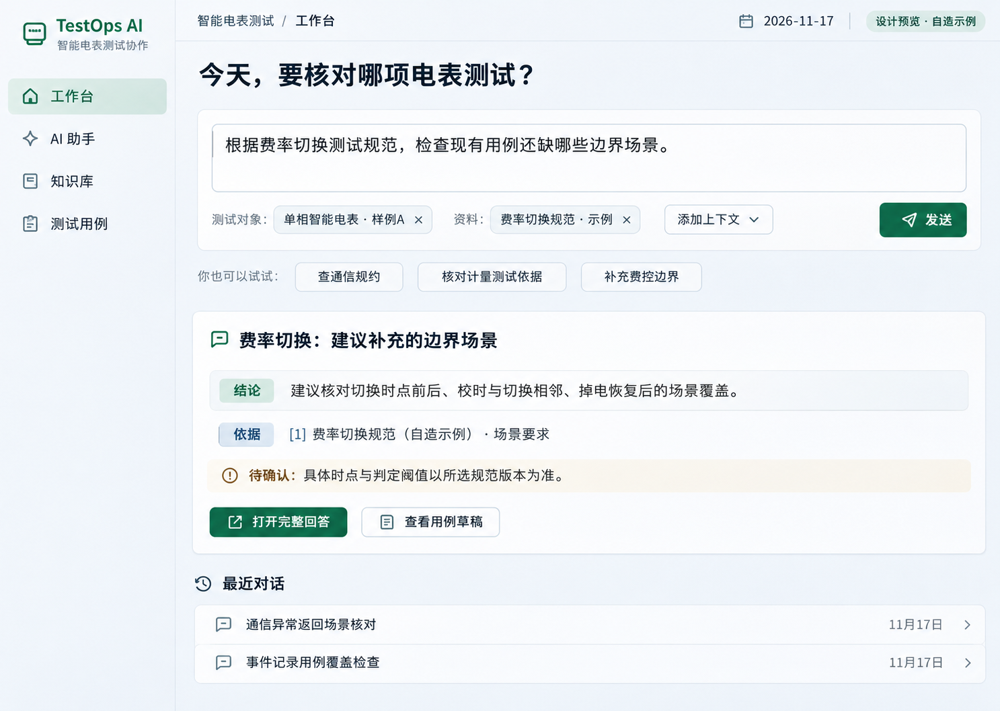
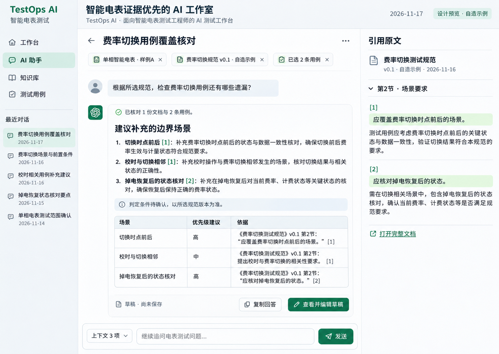
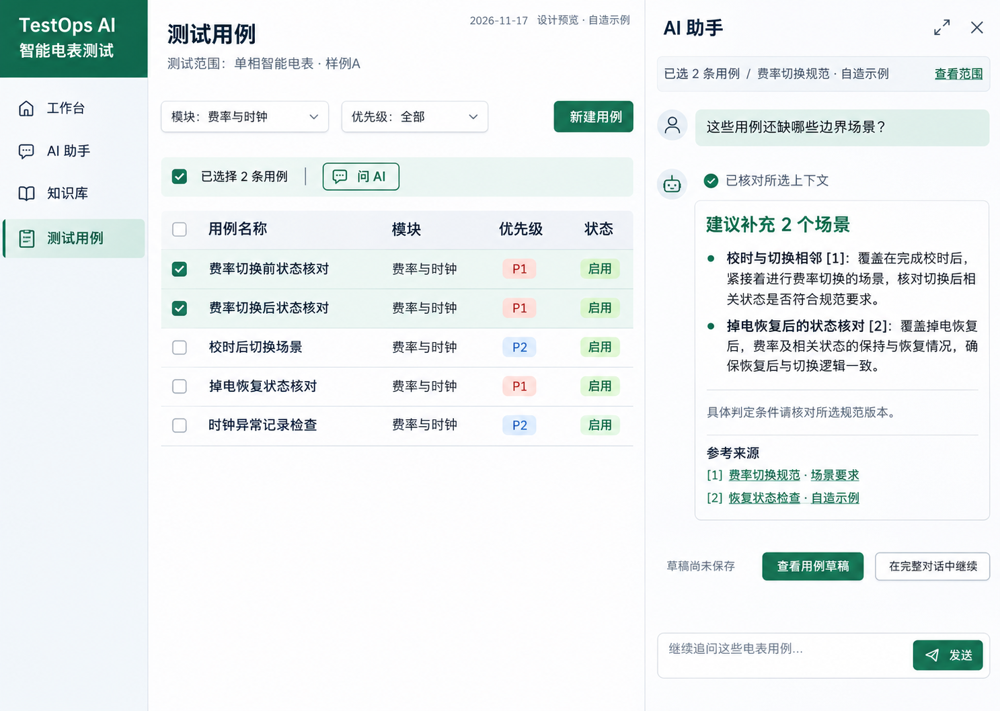

# TestOps AI 智能电表测试页面与交互总体设计稿

> 本文为 V0.1 探索历史，已被 [最终产品与页面设计 V1.0](PRODUCT_DESIGN.md) 及 [三端开发契约 1.0.0](contracts/README.md) 取代。开发以新基线为准，不再按三方向另行选型。

日期：2026-11-17。版本：V0.1，待评审。状态：IMPLEMENTED（设计材料）；下述新增产品能力均为 PLANNED。

## 1. 产品主线

面向智能电表测试工程师和研发人员，围绕一个闭环组织页面：**明确电表测试对象与适用规范 → 选择资料或用例 → 向 AI 提问 → 阅读有依据的回答 → 追问或检查草稿 → 保存为业务数据**。

用户在本轮明确了智能电表测试领域。当前仓库没有专属表型、规约版本等业务模型，以下领域结构是新设计建议，不改写原始立项文档，也不把通用 CRUD 描述为电表领域功能已实现。

### 智能电表领域组织

| 测试领域（建议分类） | 知识库内容                         | AI 帮助方式                                      |
| -------------------- | ---------------------------------- | ------------------------------------------------ |
| 电能计量             | 适用测试方法、判定依据、条件说明   | 找到对应规范条款，整理待核对条件，不自行编造阈值 |
| 通信规约             | 对应规约版本、数据项、通信异常场景 | 解释选定资料中的规则，对照用例覆盖               |
| 费率与时钟           | 费率切换、时钟与校时相关资料       | 对照切换前后及关联场景，生成待检查的用例建议     |
| 费控                 | 状态转换与测试要求等合法自造资料   | 检查边界与异常分支，形成测试草稿                 |
| 事件与记录           | 事件、记录和恢复场景的测试要求     | 建立规范条款与用例的对应关系                     |

分类可调整，不暗示所有电表均适用这些模块。知识资料按“领域 + 规范/规约版本 + 适用范围”组织，不能只建一个混杂的“电表资料”库。第一阶段通过知识库名称、描述及标签表达；正式分类与关联模型在后续契约评审后增加。

页面顶部设置可展开的“本次测试上下文”：表型/相别、产品或方案标识、软硬件版本、适用规约及版本、所选资料和用例。未知项明确显示“未指定”，可只填与问题相关的字段，不强迫每次填完整设备档案；不把这些信息自动当成已连接设备。

电压、电流、功率因数等条件如需用于具体计量问题，应由所选测试方法或用户提供，带单位并可核对；本稿不设默认数值。AI 缺少适用范围或判定条件时先指出缺项，不能给出“合格/不合格”的确定结论。实际标准号、版本和阈值以用户后续选择的合法资料为准。

首期推荐问题是“按所选费率切换规范检查用例覆盖”“查找通信异常场景要求”“这些计量测试建议还缺哪些判定条件”。日志分析在有实际导入与运行记录模型后再提供；报文解释在有规约、输入校验与解析支持后单独开放。测试台、真实电表控制、自动施加条件和执行调度不由本轮设计隐式新增。

首页首屏必须让用户看到输入框、当前资料范围和发送按钮；回答有固定位置，引用能打开原文，生成的用例有明确去向。账户信息和服务健康退到次级位置，不再占据首页主体。

本稿以 [立项方案](PROJECT_BLUEPRINT.md)、[当前 API](API.md) 和现有 Web 为依据。当前代码已具备登录和导航、Java 知识库/用例元数据 CRUD；文档上传索引、AI 对话、引用、会话持久化、用例生成和审批尚未实现。设计图片中的内容都是自造示例，不能当成运行证据。

## 2. 全站结构

主导航保持四项：**工作台、AI 助手、知识库、测试用例**。会话记录属于 AI 助手，不再单设同级业务模块；底部为账户菜单，管理员入口按实际能力逐步开放。

| 页面          | 页面职责与主要内容                                   | 主要操作                       | AI 结果去向                              |
| ------------- | ---------------------------------------------------- | ------------------------------ | ---------------------------------------- |
| 登录          | 账号密码、错误反馈、回到原访问位置                   | 登录                           | 成功后进入工作台或原页面                 |
| 工作台        | 提问框、上下文选择、三个场景提示、最近会话与最近访问 | 向 AI 提问                     | 发送后进入完整会话，首页保留最近会话摘要 |
| AI 助手       | 新会话、历史会话、消息、回答、来源阅读、草稿预览     | 提问、追问、查看引用、检查草稿 | 对话留在会话，业务草稿另行确认保存       |
| 知识库列表    | 名称、描述、可见性、可管理操作；后续增加文档就绪概况 | 创建、进入知识库               | 选择知识库后启动指定范围会话             |
| 知识库详情    | 文档列表、处理状态；设置与成员放次级页签             | 上传资料、问这个知识库         | 页面侧栏，或展开为完整会话               |
| 文档阅读      | 标题、版本、目录、正文、被引用段落                   | 问这篇文档、定位引用           | 右侧 AI 侧栏，与正文并排                 |
| 用例列表      | 项目标识/模块/优先级/状态筛选、分页与批量选择        | 新建、查看、问 AI              | 已选用例作为明确上下文传入侧栏           |
| 用例详情/编辑 | 当前接口支持的业务字段、保存反馈                     | 编辑、归档、问这个用例         | AI 建议不覆盖表单；先检查拟修改内容      |
| 用例草稿检查  | AI 建议字段、来源、必填校验、逐条选择与保存结果      | 确认保存选中项                 | 保存成功后返回真实用例链接               |

建议新增路由为 `/assistant`、`/assistant/:conversationId`、`/knowledge/:id`、`/knowledge/:id/documents/:documentId`、`/test-cases/:id`；保留现有 `/overview`、`/knowledge`、`/test-cases`。新路由只是设计，不表示当前可访问。草稿检查初期采用页内工作区或抽屉，避免为临时状态增加独立一级入口。

首期不加入任务编排、测试执行、失败率大屏、日志分析、模型市场等入口。当前没有测试运行事实，不能把用例 ACTIVE/ARCHIVED 当成通过/失败。

## 3. 三种视觉方向

三张独立概念稿展示不同的页面重心，沿用现有青绿色与浅色背景。它们是视觉选择材料，不是三个需要同时实现的系统。

| 显示顺序 | 方向                 | 核心布局                          | 适用取舍                                    |
| -------- | -------------------- | --------------------------------- | ------------------------------------------- |
| 1        | 提问优先的工作台     | 导航 + 大输入区 + 最近回答/会话   | 新用户最容易发现 AI；正式流转统一到完整会话 |
| 2        | 回答与证据并排       | 会话导航 + 对话正文 + 引用阅读区  | 适合深入查规范、核对依据；小屏需切换阅读    |
| 3        | 业务页面内的 AI 协作 | 用例表格 + 带选中上下文的 AI 侧栏 | 适合边看用例边问；长回答可展开到完整会话    |

推荐的总体组合是：用第一种表达首页、第二种承载完整 AI 工作、第三种承载业务页中的问答；共同使用同一会话、来源和草稿组件。评审时可以选择一个方向作为全站视觉基准，再细化各页面，不需要把所有布局挤进同一屏。

配图目录 `docs/assets` 承载本文配图，已有真实设计产物，不新建空产品模块。

### 方向 1

### 方向 2

### 方向 3

本轮最新三张稿已按智能电表测试重绘，以上配图仅保留领域修订版。图片中的规范、表型和场景均为自造示例。实施时以本文交互与真实资料为准；第三张草稿建议应对照所有已授权用例查重，不能将未选中但已经存在的同名场景直接当作缺失项。第二张生成图出现的第三方模型标志不作为品牌或供应商选择，实施复用现有自有图标。示意稿中的长标题和卡片密度也需在细化时收敛。

## 4. 从哪里问 AI

**入口一：工作台主输入框。** 标题“今天，要核对哪项电表测试？”，提示“例如：根据费率切换测试规范，检查现有用例还缺哪些边界场景”。框内底部展示“测试对象”“选择资料”“添加用例”，主按钮“发送”。下方仅保留“查通信规约”“核对计量测试依据”“补充费控边界”三个填入问题的快捷提示，点击提示不直接提交。

**入口二：独立 AI 助手。** 支持持续追问、会话历史和引用阅读。每个会话拥有稳定地址；侧栏可展示最近会话，“查看全部”进入完整列表。历史支持按标题搜索，删除会话需明确确认；会话与业务记录独立，删除会话不隐式归档用例。

**入口三：当前页面的“问 AI”。** 文档、知识库、用例详情、用例批量选择都有具体按钮，例如“问这篇文档”“问所选 2 条用例”。点击打开右侧栏，显示已经带入的上下文，不自动发送问题。

首期不做仅靠右下角小气泡发现 AI 的模式。顶部可提供固定“AI 助手”入口，但不能替代首页和业务页的明确入口。

### 上下文必须可见

- 显示知识库名称、指定文档/版本、选中用例数量及可展开明细；用户可以移除或重新选择。
- 区分“仅所选资料”与“当前账户可访问资料”；默认要求用户明确选择范围，不暗中扩大检索。
- 首期跨知识库检索若尚未实现，只能选择单个知识库，不放出可用假象。
- 无资料时提示“请选择知识库，或先添加资料”；用户可以显式选择“仅根据已选用例整理建议”，回答需标注未引用知识资料。
- 切换页面不悄悄改变已经开始的会话范围；需通过“添加到当前会话”或“新建会话”明确选择。
- 每条提问保存当次上下文快照，后续切换范围只影响后续提问；历史回答仍对应原有资料版本。
- 对用例筛选结果提供两个不同操作：“问已选 N 条”与“问当前筛选结果”。后者必须显示预计范围并由服务端重新查询授权，首期可只做前者。

## 5. AI 输出到哪里

### 完整会话布局

桌面 1440px：全局导航约 208px；会话列表可与导航上下组合，避免常驻四列；对话区域至少 560px；引用阅读区约 320–360px，默认按需展开。消息阅读宽度控制在约 720px。输入框固定在内容区底部，底部留白保证最后一条回答不被遮挡。

工作台发送问题后跳转到完整会话并显示这条消息与生成进度；首页最近记录只是入口，不维护另一套独立聊天。业务页侧栏内直接显示回答，“在完整对话中继续”打开同一个 conversationId，保留消息、草稿和范围。

### 回答的统一结构

1. **简短结论**：先回答问题，不先输出长篇推理。
2. **依据与限制**：正文引用 `[1]`、`[2]`，区分文档事实、工具查询结果、AI 建议和待验证推测。
3. **结构化结果**：查询用例返回表格和真实详情链接；生成用例返回待检查草稿；普通问答只返回文本，不硬加业务操作。
4. **后续动作**：复制、重试、追问；有合适结果时才显示“查看用例草稿”。

过程信息只展示真实事件摘要，如“正在检索资料”“找到 2 个片段”“正在整理回答”；可展开查看受控工具名称、结果摘要和时间。不展示模型内部思考过程，不用动画假装工具已经执行，不显示编造的置信分数。

### 引用阅读

点击正文引用，在来源阅读区打开对应文档、版本、章节/页码和高亮原文。支持“打开完整文档”和返回回答位置。Markdown 使用章节/段落，PDF 使用页码；没有页码就不编造页码。

来源删除、版本变化或权限被撤销时显示“来源当前不可访问”或“已有新版本”，不继续泄露原文；每次打开由 Java 校验权限。权限撤销后的历史消息、缓存引用与摘要展示规则也需在会话读取时由服务端处理。

## 6. 从回答进入业务数据

示例：用户提出“根据所选规范，检查费率切换用例的边界场景” → AI 结合明确的电表测试上下文给出说明与引用 → 点击“查看用例草稿” → 检查并编辑 → 确认保存 → 展示新用例链接。

草稿表按当前 API 展示 `projectKey`、`module`、`title`、`tags`、`priority`、`expectedResult`。模块可用“通信规约”“费率与时钟”等经评审的领域名称。尚无接口支持的测试步骤、接线/前置条件、测试参数、规约版本、设备型号和条款关联等字段不得伪装为已可保存；若要增加，先单独评审数据模型与契约。结构化参数必须区分建议值、资料规定值和实际测量值。

草稿始终标注“AI 生成 · 尚未保存”。项目标识等缺失字段需要用户补全，不能擅自填入真实项目。优先级只能建议，用户可修改或取消选择。AI 不直接修改既有用例。

确认按钮写明“保存选中 3 条用例”，提交前展示对象、数量与实际字段。保存成功后才标记“已保存”；部分失败时逐条保留成功 ID 和失败原因，仅重试失败项。当前仅有单条创建 API，首期可逐条保存；批量事务、幂等和来源关联字段如需持久化，必须新增正式契约后再启用，不能靠前端防重复替代服务端保证。

首期新建用例采用普通表单确认即可，不预建全平台审批中心。后续 Agent 任务写入再设计独立审批、过期与幂等执行状态。

## 7. 其余核心页面

### 知识库

列表重心为可读的名称、描述和可见性；创建/编辑只包含已有字段。详情先展示文档与问答入口，再展示管理信息。文档上传以后显示逐文件进度和可恢复错误；解析/索引未完成的文件不能加入问答范围。就绪时显示“可用于问答”。

文档状态映射为“已上传、等待处理、处理中、可问答、处理失败、删除中”。失败提供原因和有权限的重试入口；删除清理完成后才从列表移除。知识库元数据归档与文档文件/向量清理是不同动作，现有归档接口不能暗示已经清理文档。

### 测试用例

以表格为主，列表筛选与自然语言问题分开。项目标识、模块、优先级和状态使用当前 API；无服务端标题搜索时不展示全量搜索假象，可暂用模块筛选。列表支持详情、编辑与归档，归档用明确文案，不把归档写成永久删除。

用例详情在主体保留确定性数据，右侧按需打开 AI。AI 提出修改时只展示差异建议，不能覆盖未保存编辑。当前业务模型不含执行结果，暂不提供“查失败用例”“解释本次失败”快捷问题。

### 登录、账户与管理

沿用已验证登录流程、刷新校验、401 清理、403/网络故障重试及移动导航。登录页用一句话说明“查电表测试依据，整理有来源的用例建议”，不承诺尚未交付的执行能力。账户与服务诊断放次级菜单；模型配置、用户管理、审计页待对应真实能力完成后开放，不把健康探针成功表述为 AI 可用。

## 8. 状态、响应式与可访问性

| 状态              | 用户看到什么                            | 可执行操作                           |
| ----------------- | --------------------------------------- | ------------------------------------ |
| 新会话            | 输入框、上下文选择、场景提示            | 选范围、输入问题                     |
| 无就绪文档        | “资料尚未准备好，暂不能基于它回答”      | 看处理状态或换资料                   |
| 检索/生成中       | 真实阶段摘要、流式正文、停止按钮        | 停止，保留已生成内容                 |
| 证据不足          | “当前资料未找到足够依据”，标注未确认项  | 缩小问题、换资料、补资料             |
| 查询无结果        | 明确“未找到符合条件的用例”              | 调整条件，不能生成假业务行           |
| 超时/服务不可用   | 简短原因、请求标识、保留输入            | 重试或返回业务页面                   |
| 流式连接中断      | 回答标记“不完整”，保存和业务操作禁用    | 重试；恢复协议未实现前不承诺断点续传 |
| 停止生成          | 已生成内容标记“已停止”                  | 复制或重新生成，不视作完整结果       |
| 401/403           | 沿用会话清理/权限提示，不输出敏感上下文 | 重新登录或切换授权资料               |
| 保存失败/部分成功 | 逐条结果与已保存链接                    | 修改失败项后再试                     |

桌面 ≥1280px 可并排看正文与来源；768–1279px 折叠全局导航和来源，优先保证正文宽度；小屏 <768px 采用全屏会话/来源切换，业务侧栏改全屏页，返回后保持表格选择与滚动。表格可局部横向滚动，页面整体不得溢出。

输入框支持中文输入法合成，Enter 发送、Shift+Enter 换行并附可见提示；生成中主操作变为停止。交互控件有标签、焦点样式、键盘操作；抽屉 Escape 关闭并返回焦点；状态不能只靠颜色，流式内容避免逐字屏幕阅读器播报，尊重减少动效偏好。

视觉基调沿用 `#256b5b` 主色、`#102a43` 正文、`#627d98` 辅助文本、`#dce5eb` 分隔线与 `#f4f7fa` 背景。正文 14–16px，页面标题 26–30px；中文优先系统字体。正式实施复核文本对比度，尤其小字号辅助文字，不把现有 token 自动当成无障碍验收通过。

## 9. 落地顺序与跨端依赖

| 阶段         | 范围                                                          | 完成判据                                        |
| ------------ | ------------------------------------------------------------- | ----------------------------------------------- |
| 设计评审     | 选视觉基准、确认四项导航和 AI 闭环                            | 确定页面职责和核心交互，无业务上线声明          |
| 页面实现     | 工作台/AI 助手/引用/草稿状态的前端演示，业务 CRUD 接现有 Java | 演示与真实数据边界明确，核心键盘/小屏流程可验证 |
| 知识问答闭环 | 上传、处理、知识库选择、流式回答、引用定位、会话恢复          | 真实资料与服务运行，权限与无依据场景通过        |
| 用例协作闭环 | 受控查询、结构化草稿、检查保存                                | 与 Java 事实一致，部分失败/重复提交可处理       |
| 增强         | 日志、任务、审批、审计与评测                                  | 对应数据模型和服务到位后单独验收                |

前端只访问 Java；Python 承担 AI，Java 决定业务写入和授权。本稿不更改现有 API，也不冻结新事件字段。实施前需跨端确认：会话及逐消息上下文、上传状态、引用定位及版本、流式阶段/完成/失败/取消、结构化结果、保存来源与幂等。前端布局可以先确定，真实 AI 的可用状态必须由实际服务能力决定。

## 10. 设计验收场景

1. 用户进入首页即可发现提问框、选择资料、发送问题，在同一个会话中看到回答并追问。
2. 从知识库或所选用例启动 AI，发送前能说清当前范围，切换页面不会串上下文。
3. 点击引用能核对真实原文与版本；无依据、无权限、资料未就绪有独立状态。
4. AI 草稿可以编辑与放弃，未确认前业务库不新增；确认后可打开真实用例，重复点击和部分失败不会伪装成功。
5. 停止、断网、超时、401/403、刷新与窄屏均有可恢复路径，不丢失未提交输入或悄悄执行业务写入。

本轮只验收设计材料、格式与工程记忆。上述产品场景需在实现后通过真实前后端与浏览器验证，不能以设计图片替代。
