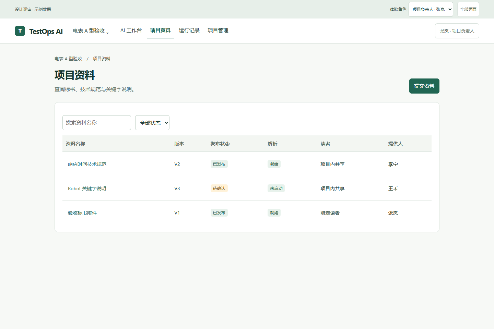
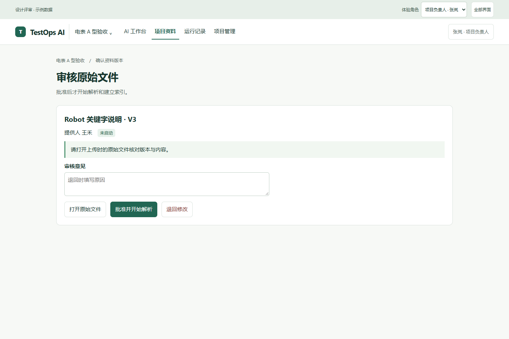
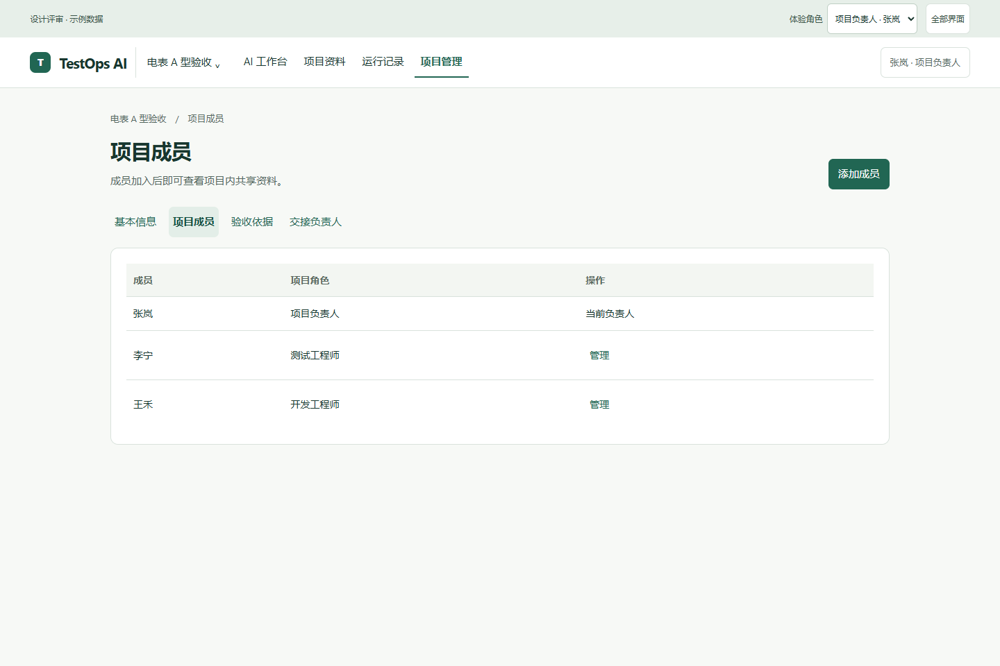
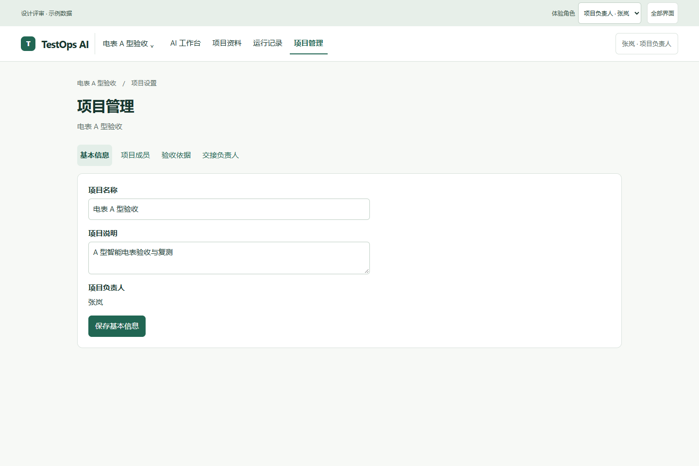
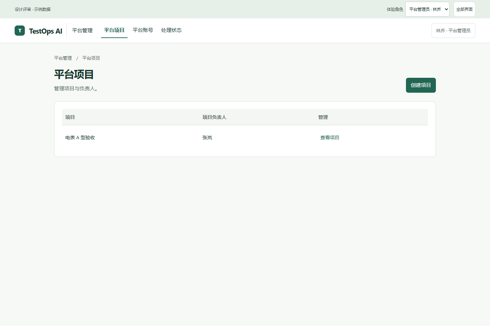
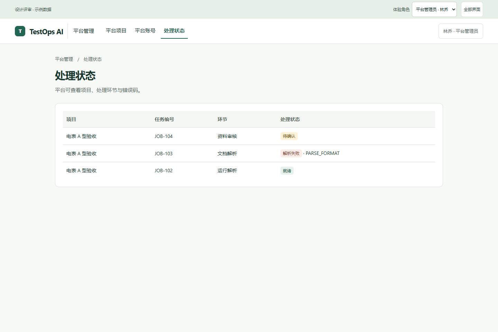
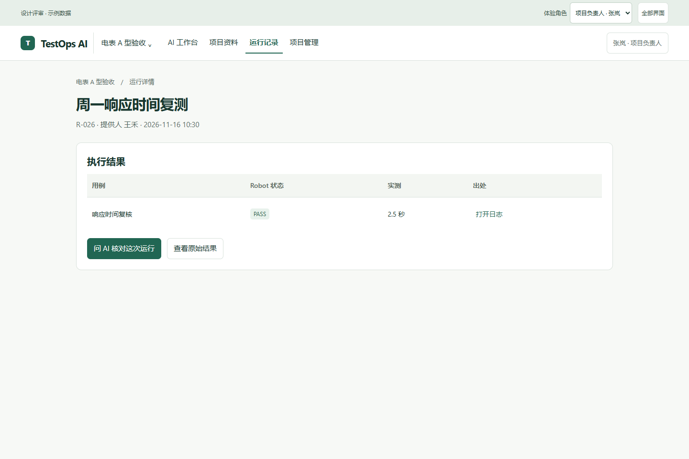
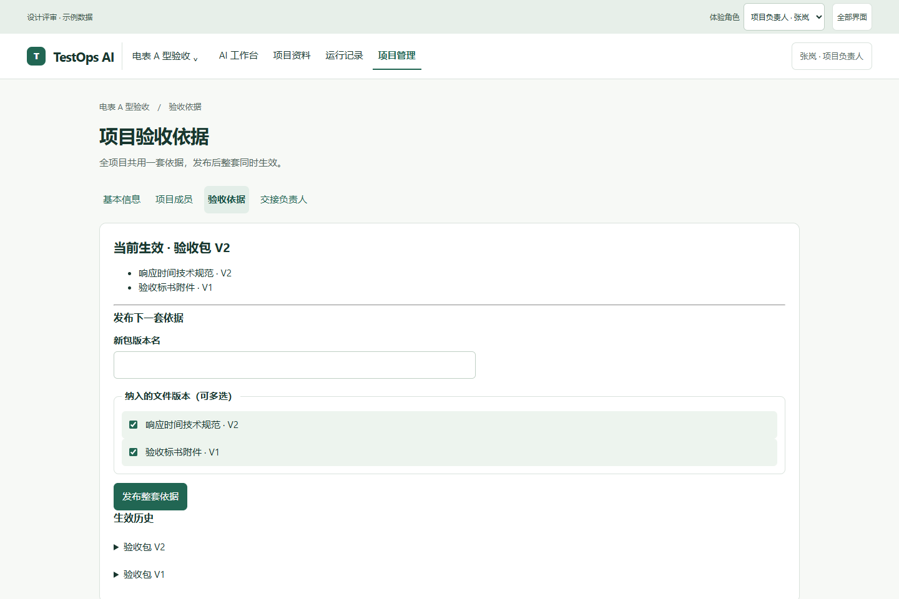

# 全界面样稿走查

2026-11-19 · 基于 main 039c831 的设计评审文件。本地浏览器直接打开 [index.html](index.html)，点击顶部“全部界面”或切换四种角色。默认先进入项目资料，方便审查管理界面；正式产品登录后的默认入口为 AI 工作台。

## 已验证

- 本机 Edge / Playwright 打开 27 个页面状态，在 1440×960 与 390×844 各检查一次。54 次页面检查均能读取标题/主内容，页面根节点无横向溢出，自动走查未收到页面脚本异常。
- 添加成员、调整入口与确认移出；测试提交资料后开发不可见、负责人发布后开发可见；开发看不到示例受限附件。
- 在私人对话附 XML → “去登记复测”带入文件 → 独立页面确认 → “回到原对话”；运行判定打开 V2 条款与完整资料；平台账号创建项目并指定负责人；创建普通账号。另验负责人发起申请、平台确认、填写离岗原因代办、退回时就近提示并聚焦原因字段、两份文件整包生效与旧包查阅。
- 样稿在浏览器内存中模拟操作，刷新复位。真实服务、SSE、授权、凭据、模型和数据库交给[三端联合验收](../development/PARALLEL_DEVELOPMENT.md)。截图使用自造内容。

## 管理页面预览

| 项目资料                           | 版本审核                           |
| ---------------------------------- | ---------------------------------- |
|   |    |
|   |  |
|  |      |
|       |     |

## 交互回归

在仓库根运行 `node tests/contracts/workspace-design.cjs`。脚本需要 Playwright 和 Chromium；已独立安装时，通过 TESTOPS_PLAYWRIGHT_MODULE 与 TESTOPS_BROWSER_PATH 指向所在位置。默认只检查；显式设置 TESTOPS_REFRESH_PREVIEWS=1 才更新本页八张预览。除 54 项视口走查，还实际测量条款按钮热区、Tab/Shift+Tab 焦点循环、Esc 归焦及减少动画设置。正式版另按 [Web 交互验收表](../development/WORKSPACE_WEB.md)检查软键盘、读屏、200% 缩放和真实断线恢复。
