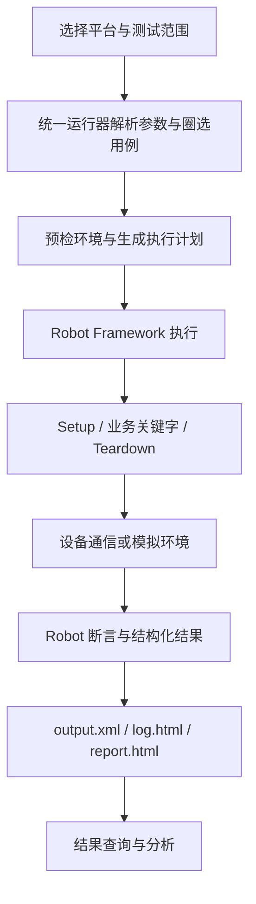
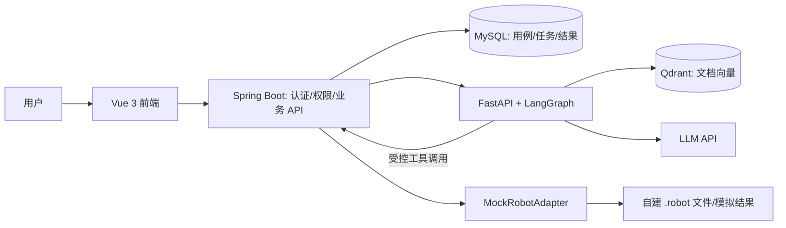

# TestOps AI · Robot Framework 自动化测试平台业务背景与领域参考

> 文档版本：V1.0  
> 文档用途：作为 **TestOps AI（智能测试知识库与 AI Agent 协作平台）** 的业务背景、领域模型输入与研发约束，可保存为 `docs/ROBOT_TEST_BACKGROUND.md`。  
> 编制依据：《自动化测试项目复盘（对外可保留版）》《自动化测试项目复盘》《自动化测试项目·工作事实梳理与简历素材》及《TestOps AI 项目立项与研发实施方案 V1.0》。  
> 重要边界：本文以**脱敏、可公开讨论的技术事实**为基础；没有复制原公司的代码、用例正文、设备配置、密钥、内部日志或数据。个人 TestOps AI 项目**不直接连接、复制或继承原企业系统**。

## 0. 一页结论

原工作项目是一套以 **Robot Framework** 为测试用例执行核心的智能设备自动化测试平台。它将设备通信、测试台体控制、业务关键字和 Robot Framework 测试用例组合起来，通过统一运行器完成测试范围筛选、执行与结果归档，并提供基于 **FastAPI + Vue 3** 的 Web 控制台供用户查询、筛选、编排用例和生成执行命令。

个人新项目 **TestOps AI** 不替代 Robot Framework、不重新造测试执行框架，而是在**自建模拟测试域**之上增加 Java 业务后端、知识库、日志诊断和 Agent 工具协作：

- **Robot Framework / 确定性业务层：** 负责定义与执行测试步骤，并产出可信的结构化测试结果。
- **Web 测试管理层：** 负责用例发现、筛选、编排、命令/执行计划生成以及结果展示。
- **TestOps AI 智能协作层：** 负责自然语言理解、知识检索、测试用例查询、日志解释和任务建议；实际查询与写入仍由受控业务服务执行。

**关键设计原则：结构化事实用数据库/API 精确查询；规范文档和故障知识用 RAG 语义检索；Agent 负责选择工具与整合证据，不直接执行任意命令或接触真实设备。**

---

## 1. 原智能设备自动化测试平台：业务背景

### 1.1 业务目标

该平台服务于智能电能表等智能设备的功能验证、版本回归和问题复现。典型测试会：

1. 确定被测设备所属平台、通信方式和必要测试环境；
2. 配置测试台体（例如供电、负载）并与设备建立通信；
3. 按测试规范执行读参数、写配置、查询事件、验证状态等测试动作；
4. 对设备返回数据进行断言，生成通过/失败等结论；
5. 归档日志与报告，用于排障、复测和回归。

底层测试采用 Robot Framework；设备交互依赖业务关键字及协议客户端（例如 DLMS/COSEM 相关通信能力）。对于个人新项目，不需要复现真实电表协议与物理台体，应使用**安全的模拟用例、模拟执行器和模拟日志**保留同类业务逻辑。

### 1.2 原工程面临的主要问题

| 问题 | 对测试工作的影响 | 原工作项目中的工程应对 |
|---|---|---|
| 多代设备平台存在差异，差异散落于用例、关键字和配置 | 修改成本高、容易遗漏 | 差异总账、平台适配器、准入校验与结构守卫 |
| 命令行入口不统一、人工组合参数 | 测试范围不透明、结果难复现 | 统一 Python 运行器、分层圈选、明确产物目录 |
| Web 与 CLI 如果各自实现筛选规则 | 相同选择条件可能命中不同用例 | Web 复用运行器的圈选语义，并进行一致性反核 |
| 测试链路涉及设备、台体、通信及框架 | 失败原因难定位 | 分层测试、结构化结果、日志和状态/时序分析 |
| 仅靠 CLI 查看与筛选用例 | 新人上手和复杂操作成本高 | FastAPI + Vue 3 Web 控制台 |
| 规范、经验和故障原因分散 | 知识复用困难 | 规范文档、工程记忆、问题记录及自检机制 |

最后一项正是个人 **TestOps AI** 引入 RAG 与 Agent 的业务动机：把测试知识和结构化运行数据连接起来，帮助用户更快查询、理解和处理测试工作。

---

## 2. Robot Framework 的领域模型

### 2.1 必须理解的核心对象

| 对象 | Robot Framework 中的含义 | 在 TestOps AI 中的推荐建模 |
|---|---|---|
| **Test Suite（测试套件）** | 一组测试用例的组织单元，常与文件/目录对应 | `test_suites`，维护父子关系、所属项目、来源 |
| **Test Case（测试用例）** | 验证某个行为或业务场景的独立测试 | `test_cases`，记录名称、所属 Suite、Tags、文档、状态 |
| **Keyword（关键字）** | 可复用的测试操作，来自内置/库/资源文件/用户定义 | `test_keywords`，记录名称、参数、说明、来源 |
| **Resource（资源文件）** | 共享关键字及变量的 `.resource` 文件 | `resource_files`，关联引用关系（MVP 可先不持久化） |
| **Variable（变量）** | 测试参数、环境参数或运行时数据 | `case_parameters` / 规范化参数结构（注意脱敏） |
| **Tag（标签）** | 用于归类、筛选或制定执行范围的元数据 | `test_case_tags`，支持精确过滤 |
| **Setup / Teardown** | 测试/套件开始前与结束后的准备和清理 | `lifecycle_hooks`（初期可作为解析元数据） |
| **Execution / Run（运行）** | 一次有确定用例集合及配置的执行实例 | `test_runs`，记录选择快照与执行状态 |
| **Result（结果）** | 测试用例的 PASS/FAIL/SKIP 等状态、消息和耗时 | `test_results`，关联 `test_run_id` 与 `test_case_id` |
| **Artifact（产物）** | `output.xml`、`log.html`、`report.html` 等 | `test_artifacts`，记录文件类型、路径、归属与校验信息 |

注意：**Test Case 是可结构化查询的业务对象，不应仅作为一段文本送入向量库。** Tag、Suite、执行状态和运行时间等字段应当采用数据库查询，AI 可以在解释结果时再引入语义检索。

### 2.2 Robot 用例的通用写法（完全自造示例）

以下内容用于理解领域结构，**不是原公司用例，也不代表真实设备操作**：

```robotframework
*** Settings ***
Documentation     示例登录流程测试套件
Resource          ../resources/demo_keywords.resource
Test Tags         demo    web

*** Variables ***
${DEMO_USER}       learner

*** Test Cases ***
Login Succeeds With Valid User
    [Documentation]    验证模拟系统的正常登录路径
    [Tags]    smoke    authentication
    Open Demo Session
    Submit Demo Login    ${DEMO_USER}
    Login Should Succeed

Login Fails With Invalid User
    [Tags]    regression    authentication
    Open Demo Session
    Submit Demo Login    invalid-user
    Login Should Be Rejected
```

对应的资源文件可以定义 `Open Demo Session`、`Submit Demo Login` 等自造关键字。在真实 Robot Framework 工程中，关键字可能继续调用 Python 库与底层协议模块。

**解析时要区分：** 文本源码中的用例定义、实际筛选后准备运行的用例集合、一次执行后得到的结果记录，这三者不是同一个概念。

### 2.3 知识与数据的分类

| 信息类型 | 示例 | 最适合的处理方式 |
|---|---|---|
| 结构化测试元数据 | Suite、Case、Tags、优先级、所属模块 | MySQL + Java API 精确过滤 |
| 测试定义与步骤 | Robot 文件中的用例步骤、关键字参数 | Robot 解析器结构化抽取；必要时建立全文搜索 |
| 执行结果 | Run、PASS/FAIL、耗时、错误消息 | MySQL 结构化持久化和查询 |
| 测试报告 | Robot 的 `output.xml` 与可阅读报告 | 解析 `output.xml` 生成标准化结果；HTML 仅展示 |
| 规范知识 | 测试规范、故障手册、操作说明 | 文档切块 + Embedding + RAG |
| 非结构化日志 | 模拟异常栈、错误上下文 | 日志解析 + 结构化错误特征 + RAG 辅助诊断 |
| 操作指令 | “找出登录模块失败用例” | Agent 意图识别 → 白名单工具调用 → 结构化结果 |

---

## 3. 原测试平台的典型技术链路

### 3.1 业务流程



### 3.2 Web 控制台与运行器的关系

原 Web 控制台由本人独立实现前后端子系统，主要技术栈为 **FastAPI、SQLAlchemy/SQLite、Vue 3、TypeScript、Pinia、组件库、Playwright**。其主要功能包括：

- 对 Robot 用例建立静态索引，支持搜索、标签筛选、排序和查看步骤；
- 跨页选择用例，并根据统一运行器的规则计算命中集合；
- 生成运行命令/执行计划，避免 Web 再发明一套筛选语义；
- 提供可视化编排画布、关键字查看/编辑能力和结果查看入口；
- 使用自动化测试和一致性脚本校验核心逻辑。

**准确边界：** 原有 Web 接口以**读取和计算**为主。不能把“生成执行计划与运行命令”自动写成“Web 已实现完整异步任务调度、真实设备自动执行和 AI 智能决策”。如有后来新增的上线或执行能力，需另有代码、部署与使用证据。

### 3.3 452 组一致性校验的准确含义

原项目中，通过自动化脚本用**452 组筛选/执行计划输入**比对 Web 与统一运行器得到的用例命中集合，验证两种入口在“选中哪些测试”的业务规则上保持一致。

- **不是**“编写了 452 条 Robot Framework 用例”；
- **不是**“执行了 452 次真实设备测试”；
- **不是**“测试覆盖率达到 452%”之类的效果指标；
- 它体现的是**跨入口业务语义一致性校验**，也是新项目应继承的工程思想。

---

## 4. 两个简历项目的定位与关系

| 维度 | 项目 A：原智能设备自动化测试 Web 平台 | 项目 B：TestOps AI（新个人项目） |
|---|---|---|
| 项目来源 | 真实企业工作经历 | 从零开发的个人作品 |
| 核心技术 | Python、Robot Framework、FastAPI、Vue 3、SQLite | Java、Spring Boot、Vue 3、Python FastAPI、LangGraph、Qdrant |
| 核心目标 | **可靠地管理和编排确定性测试流程** | **理解测试知识、解释结果并协助业务操作** |
| 业务对象 | Robot 用例、关键字、执行计划、测试报告 | 用例元数据、知识文档、运行记录、Agent 会话、审计 |
| 重点能力证明 | 既有复杂工程改造、全栈交互、运行器语义复用、测试验证 | Java 企业后端、RAG、Agent 工具编排、权限控制、多服务部署 |
| AI 的角色 | AI 辅助研发，提高代码分析与工程验证效率 | AI 是产品业务能力的一部分，提供检索、分析和受控工具调用 |
| 数据来源 | 原公司的真实测试工程，仅限企业内部 | **独立编写的模拟 Robot 用例、公开资料、自造日志** |
| 集成关系 | **不直接接入个人项目** | 使用自建 `MockRobotAdapter`，演示相同类型的业务操作 |

### 4.1 逻辑互补而非复制

项目 A 解决“**测试怎么准确选、怎么可靠地运行和展示**”。项目 B 解决“**测试人员如何更快找到知识、理解失败、查询用例和形成处理建议**”。

可以把 B 看作围绕类似测试业务建立的**新一代独立智能协作产品原型**，但不应描述为原公司平台的官方二期、原企业系统升级版或得到原企业授权的集成产品。

### 4.2 个人项目中的推荐演示架构



- Java 为权限和业务数据的**权威来源**；Python AI 服务不直接绕过 Java 查询任意业务表。
- `MockRobotAdapter` 面向**公开自造**的 `.robot` 和演示执行结果；MVP 优先支持解析与只读查询，执行功能放到增强阶段。
- 向量检索必须带用户和知识库权限范围，不能仅依靠 Prompt 进行隔离。
- 写操作要有服务端鉴权、用户确认、幂等控制和审计。

---

## 5. TestOps AI 的优先业务场景（基于 Robot Framework）

### UC-01：自然语言检索 Robot 测试用例

**示例问题：**“帮我找出登录模块所有标记为 smoke 的 Robot 用例。”

1. Agent 判断是**结构化查询**，而不是先做向量检索；
2. 调用 `search_test_cases` 工具，参数包括模块、标签、分页；
3. Java 后端进行用户权限过滤，再查询自造用例索引；
4. 返回 Suite、Case、Tags、摘要、用例详情引用；
5. Agent 整理结果，不修改测试用例。

**验收：** 查询结果与直接调用 Java API 一致；无权数据不可见；参数不合法时返回明确错误。

### UC-02：问答解释测试规范和关键字

**示例问题：**“为什么某类测试需要先初始化环境，再执行业务关键字？”

1. Agent 判断需要解释**文档知识**；
2. 通过 RAG 检索自造《测试流程规范》《关键字说明》；
3. 根据找到的文档片段回答，并显示出处；
4. 找不到有效证据时明确告知，而不是猜测。

**验收：** 来源链接对应真实文档片段；跨知识库权限隔离；无资料时合理降级。

### UC-03：基于 Robot 执行产物解释失败

**示例问题：**“上次回归有哪些失败用例？失败集中在哪些关键字？”

1. Java API 精确查询演示 `test_runs`、`test_results`；
2. 通过自造 `output.xml` 或解析后的标准化数据定位失败用例和错误消息；
3. Agent 可进一步调用日志分析工具、查故障知识库；
4. 汇总失败列表、可能原因及依据，区分**观测事实**和**推测**。

**验收：** PASS/FAIL 统计与结构化结果一致；不会仅从 `report.html` 的可视文本推断结论；不伪造根因。

### UC-04：测试任务建议与人工确认（增强阶段）

**示例问题：**“帮我安排一组与登录相关的回归测试。”

1. Agent 先推荐用例集合与选择理由；
2. 后端再次校验用例权限、可执行性与参数；
3. 用户看到最终执行计划并明确确认；
4. Java 创建模拟任务，委托**受限的演示执行器**执行；
5. 系统记录任务状态、执行结果和审计信息。

**验收：** 未确认不能执行；相同确认请求不会重复创建任务；AI 无法执行任意 Shell、连接真实设备或绕过权限。

---

## 6. MVP 应该落地的数据模型

以下为**新个人项目建议**，并非原企业数据库结构。先做最小可用模型，不要为了技术展示一次创建几十张表。

| 实体 | 建议关键字段 | 用途 |
|---|---|---|
| `test_suites` | `id, project_id, parent_id, name, source_path` | Robot 套件层级 |
| `test_cases` | `id, suite_id, name, documentation, source_ref, content_hash` | 用例定义与检索 |
| `test_case_tags` | `case_id, tag` | 标签的精确过滤 |
| `test_keywords`（可后置） | `id, name, source_type, description` | 关键字说明与引用 |
| `test_runs` | `id, project_id, status, selected_case_count, started_at` | 单次执行记录 |
| `test_results` | `id, run_id, case_id, status, message, elapsed_ms` | 用例结果与失败分析 |
| `test_artifacts` | `id, run_id, artifact_type, location, checksum` | Robot 产物追踪 |
| `knowledge_bases` / `documents` | `id, owner_id, visibility, status, ...` | 知识库元数据与权限 |
| `agent_sessions` / `tool_calls` | `id, user_id, tool_name, status, ...` | AI 会话、工具调用审计 |

**建模注意：**

- 用例的唯一标识不要仅依赖名称；同名用例可能存在于不同 Suite。可以以 `project + suite_path + case_name` 推导稳定业务键，再用数据库 ID 作为主键。
- 同一用例定义可以在多个 Run 中被执行；`test_cases` 与 `test_results` 是**一对多**关系。
- 结果状态和测试用例是否启用属于两个不同维度，不能混在同一个 `status` 字段。
- `.robot` 文件路径、标签、关键字参数在模拟数据中应允许变化；索引重建需要去重、增量更新、删除失效数据的规则。
- 解析日志和引用文档时，保留 `source_ref`/`line` 或 `artifact_id` 以便溯源。

### 6.1 建议的 AI Tool 白名单

| Tool | 输入 | 返回 | 权限与副作用 |
|---|---|---|---|
| `search_test_cases` | `module, tags, keyword, page, size` | 用例元数据及分页 | 只读；Java 校验资源权限 |
| `get_test_case_detail` | `case_id` | Suite、步骤摘要、关键字 | 只读；Java 校验用例访问权 |
| `get_run_summary` | `run_id` | 总数、通过、失败、跳过 | 只读；Java 校验运行记录访问权 |
| `get_failed_cases` | `run_id, page, size` | 失败用例、错误消息 | 只读；Java 校验运行记录访问权 |
| `search_knowledge` | `kb_ids, query` | 带引用的片段 | 只读；向量库检索时落实权限过滤 |
| `create_mock_run`（增强） | `case_ids, options, approval_id` | 模拟任务 ID | 有副作用；必须鉴权、审批、幂等、审计 |

MVP 优先实现前五项中的最核心两到三项（例如 `search_test_cases`、`get_test_case_detail`、`search_knowledge`）。不建议一开始就开发任意 Python/Robot 命令执行工具。

---

## 7. 模拟数据与可演示交付物

为了不依赖企业资产，建议仓库内单独建立脱敏的**自造示例**：

```text
examples/
└── robot-demo/
    ├── suites/
    │   ├── auth.robot
    │   ├── device_status.robot
    │   └── config_validation.robot
    ├── resources/
    │   └── demo_keywords.resource
    ├── documents/
    │   ├── testing_guidelines.md
    │   ├── keyword_reference.md
    │   └── troubleshooting.md
    └── results/
        ├── sample_output.xml
        └── sample_error_log.txt
```

### 建议最小数据集

- 3 个独立 `.robot` Suite，覆盖鉴权、模拟状态读取、模拟配置验证；
- 至少 12 条自造 Robot 用例，带 `smoke`、`regression`、`negative` 等标签；
- 一份成功与一份失败的模拟执行结果，失败原因涵盖断言不匹配、环境准备失败、关键字异常；
- 3 份自造知识文档：测试规范、关键字手册、常见故障排查；
- 10 个有期望答案的自然语言查询，覆盖精确检索、知识问答、运行结果解释和越权拒绝。

以上数字是**开发验收目标**，不是原工作项目真实统计。

### 建议验收脚本

1. 导入 `.robot` 后，Suite/Case/Tags 数量与解析器输出一致；
2. `smoke` 标签过滤结果与 Java 查询一致；
3. 删除某个测试文件并重建索引后，无失效记录残留；
4. 解析示例 `output.xml` 后，PASS/FAIL/SKIP 统计与原始文件一致；
5. Agent 查询用例与直接调用后端 Tool API 返回同一集合；
6. Agent 回答知识库问题时有可核查引用；
7. 用户 A 无法检索用户 B 的私有知识库或测试结果；
8. 未经过人工确认不得提交模拟执行任务。

---

## 8. 逐阶段开发建议（与原 TestOps AI 里程碑衔接）

| 阶段 | Robot 业务域相关交付 | 需要理解的关键知识 |
|---|---|---|
| **M0：立项与设计** | 本背景文档；实体关系图；API 契约；MockAdapter 边界 | Robot Suite/Case/Keyword/Result；确定性查询与 RAG 的区别 |
| **M1：Java 后端** | 自造用例 CRUD/索引 API、Tag 查询、RBAC 数据隔离 | Spring MVC、MyBatis-Plus、MySQL 设计、索引、鉴权 |
| **M2：Vue 全栈** | 用例列表、套件树、标签筛选、详情页、权限交互 | Vue 3、TS、Pinia、前后端分离 |
| **M3：知识问答** | 自造规范知识库、RAG 引用、SSE 对话 | FastAPI、Embedding、Qdrant、RAG、检索评测 |
| **M4：Agent 工具** | `search_test_cases`、`get_run_summary` 等工具调用；增强期模拟任务确认 | LangGraph、Tool Calling、工具权限、状态/审计 |
| **M5：工程验证** | Robot 解析与查询一致性、权限回归、失败诊断评测、部署演示 | 自动化测试、Docker、日志与故障定位 |

**优先级建议：** 第一个可演示闭环应是“导入自造 Robot 用例 → Java API 精确搜索 → Vue 展示 → Agent 用自然语言调用同一个查询接口”。完成后再接入 RAG 和日志分析。这条路线既有明确业务价值，也容易在面试中解释系统边界。

---

## 9. 简历与面试中的准确表述

**原工作项目：**

> 参与基于 Robot Framework 的智能设备自动化测试平台开发，负责多平台适配、统一执行入口及工程化改造；独立实现 FastAPI + Vue 3 Web 控制台，支持 Robot 测试用例检索、标签筛选、执行计划生成、可视化编排与结果查看，并通过 452 组计划一致性校验保障 Web 与 CLI 的用例圈选语义一致。

**新个人项目（待实际完成后再用于投递）：**

> 基于 Java Spring Boot、Vue 3 和 Python FastAPI + LangGraph 设计并实现智能测试知识库与 AI Agent 协作平台；围绕自建 Robot Framework 模拟测试域完成用例精确查询、RAG 知识问答、测试结果分析与受控工具调用，通过权限隔离、来源引用与自动化测试保障 AI 应用的可靠性。

**两个项目之间的关系：**

> 原项目让我理解了 Robot Framework 测试用例、执行计划和结果管理的真实工程问题；新项目在独立模拟环境中，将这套领域知识用于 Java 全栈与 AI Agent 应用的设计与实现。两者业务相关，但代码、数据和部署彼此独立。

**不能混淆的说法：**

- 不能把个人项目描述为原公司项目的实际升级、官方集成或后续交付；
- 不能把测试命令生成写成 AI 自主驱动真实设备；
- 不能把 452 组计划校验写成 452 条用例或 452 次硬件测试；
- 不能在未完成新项目功能前声称 RAG、Agent、权限和模拟执行已经上线；
- 原项目“上线”的具体含义（内部演示、部署使用、正式生产）应以你实际可出示的记录表述。

---

## 10. 项目资料来源和使用限制

本背景文档综合下列本人提供的资料：

1. **《自动化测试项目复盘（对外可保留版）》**：脱敏项目背景、分层、模块职责、个人贡献与技术经验；
2. **《自动化测试项目复盘》**：Robot Framework 组织与执行链路、Web 控制台、统一运行器与结果产物等技术细节；
3. **《自动化测试项目·工作事实梳理与简历素材》**：Git 证据和量化口径校核，尤其是个人负责边界、452 组一致性校验的真实含义；
4. **《TestOps AI 项目立项与研发实施方案 V1.0》**：新项目立项目标、Java/Python/Vue 分层、权限安全、模拟适配与里程碑。

**使用要求：** 仅将本文件及自行编写的公开示例提交到个人 Git 仓库。上述内部核对底稿不应原样上传；不导入原企业 `.robot`、`.resource`、真实 `output.xml`、测试台体配置、设备报文或客户资料。

**文档状态：** 背景已梳理；第 5～8 章是 TestOps AI 的**设计建议/计划**，不是已经实现的功能清单。后续如架构有变化，应更新 `docs/ADR/` 和项目 `.memory/`，并维护本文件的版本记录。
